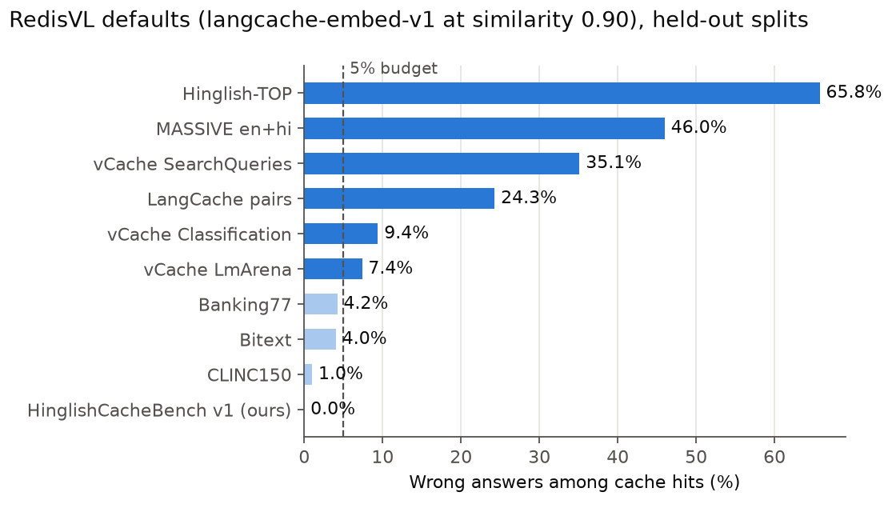
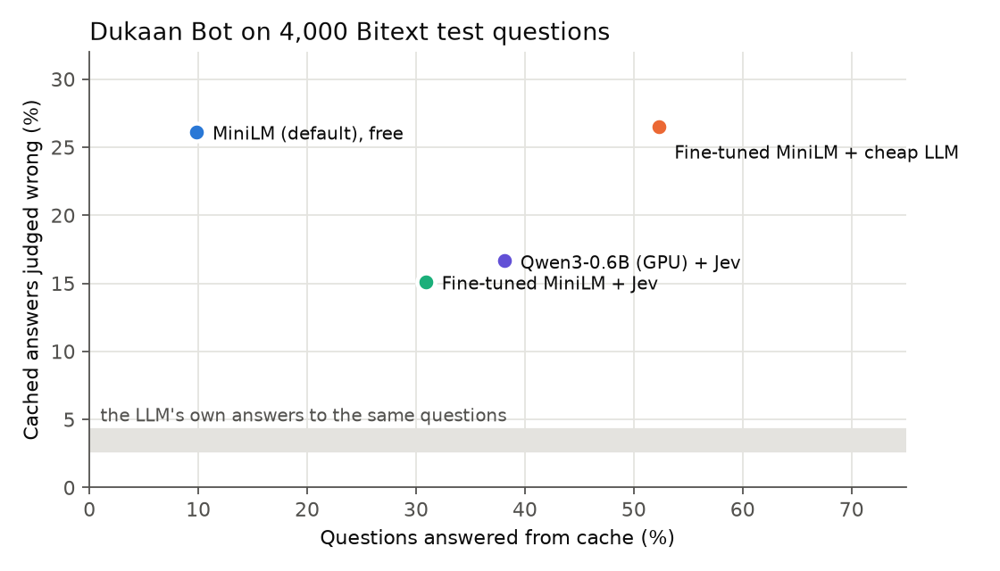
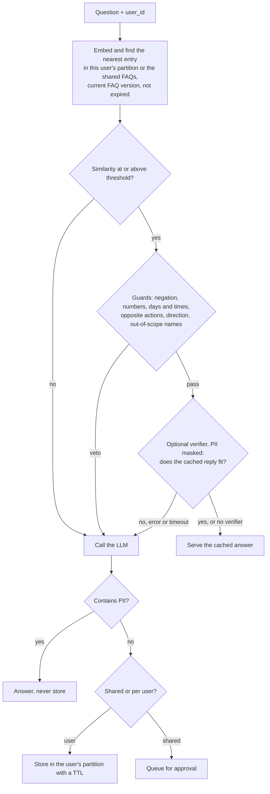

# pakka

**Measure and cut the wrong answers a semantic cache serves, in English and Hinglish support bots.**

A semantic cache answers a repeat question from memory when its meaning matches an earlier one. Redis, Azure,
Kong, LiteLLM and most gateways ship one. None of them tells you **how often the cache serves a confident,
wrong answer.** Pakka measures that, blocks the common causes, and keeps the cache from leaking or going stale.
It is a Python library plus a benchmark, tested on nine public datasets other people built and labelled, plus
315 messages real people wrote.

*Pakka* is Hinglish for "sure": *pakka sure hai?*

## Results



- **Defaults are not safe.** RedisVL's out-of-the-box cache (`langcache-embed-v1` at similarity 0.90) serves more
  than 5% wrong answers on 6 of 10 datasets, from 7% (vCache LmArena) to 66% (Hinglish-TOP). No single threshold
  carries over between datasets or embedders.
- **In a real bot, a cache saves money but is wrong far more often than the LLM.** Dukaan Bot on 4,000 held-out
  Bitext questions, every served reply checked by three LLM judges: the cache answers 10–52% of questions and
  cuts LLM spend by 10–51%, but 15–27% of the cached answers are wrong, against 3–4% for the LLM's own answers
  to the same questions (6–9 times as often).
- **Real Hinglish is much harder than LLM-written Hinglish.** On 258 messages people wrote, the free default
  answers 3 (1 wrong). v1's LLM-written test made pakka look far better than this; see
  [what v1 got wrong](docs/report.md#limitations).

**The real-bot run** (Phase 10): 4,000 Bitext test questions, Bitext's 27 e-commerce answers as the knowledge
base, `claude-haiku-5.5` as the LLM. Wrong = judged wrong by the LLM judges, not by intent labels.

| Setup | Answered from cache | Wrong answers served (95% upper) | Hit time p50 | LLM spend saved, verifier paid |
|---|---|---|---|---|
| No cache | 0 | LLM's own: 3–4% | 1,248 ms | - |
| **MiniLM-L12 (default), free** | 9.8% | 103 of 394: 26% (31%) | 9 ms | 9.9% |
| Fine-tuned MiniLM + cheap LLM verifier | 52.3% | 554 of 2,091: 26.5% (28%) | 777 ms | 51.3% |
| Fine-tuned MiniLM + Jev verifier | 30.9% | 187 of 1,236: 15% (17%) | 326 ms | 27.8% |
| Qwen3-0.6B (GPU) + Jev verifier | 38.1% | 254 of 1,525: 17% (19%) | 379 ms | 35.1% |



Most of those wrong answers come from a few FAQ answers that only fit their own seed question: Bitext's "cancel
order" answer just says "please ask your question" (27 of the free setup's 103, 61 of Jev's 187). **Seed a cache
with answers that stand on their own.**

**Our own sets**, guards on, threshold picked on v1's dev split. Cells are right / wrong answers served from cache
(95% upper bound on the false-hit rate). v1 test is 526 LLM-written questions; human test is 258 messages real
people wrote (80% romanized Hinglish), the harder and more honest one.

| Setup | v1 test (526) | Human test (258) | Hinglish caught (human) |
|---|---|---|---|
| **Free:** MiniLM-L12 (default), 0.79, 10% budget | 47 / 5 (20.6%) | 2 / 1 (79.2%) | 0/184 |
| **Free:** Qwen3-Embedding-0.6B (GPU option), 0.925, 10% budget | 102 / 8 (13.7%) | 11 / 0 (25.9%) | 6/184 |
| MiniLM-L12 + cheap LLM verifier | 118 / 6 (10.2%) | 23 / 0 (14.3%) | 12/184 |
| MiniLM-L12 + Jev verifier | 96 / 1 (5.6%) | 19 / 0 (16.8%) | 10/184 |
| Fine-tuned MiniLM-L12 (opt-in) + Jev | 148 / 3 (5.7%) | 54 / 1 (9.6%) | 44/184 |
| Qwen3-0.6B + cheap LLM | 231 / 13 (8.9%) | 113 / 9 (13.4%) | 97/184 |
| Qwen3-0.6B + Jev | 181 / 3 (4.7%) | 80 / 1 (6.7%) | 67/184 |

Without a verifier no threshold fits a 5% budget for either embedder. Everything: [the tech report](docs/report.md),
[public results](docs/public_results.md) (every table, with a one-command reproduce) and the
[lab notebook](docs/results.md).

## When pakka helps, and when it doesn't

**It helps when:**
- you run a **high-volume FAQ or support bot** where many people ask the same few things;
- your users write **Hinglish or Hindi**: the guards read *nahi*, *kal*, *band karo*, Devanagari digits and the like,
  and the benchmark tells you how your embedder does on real Hinglish;
- you are **cost-sensitive**: free hits take 9 ms on a CPU instead of a 1.2 s LLM call;
- you are **multi-tenant with PII**: per-user partitions, a PII gate that never stores Aadhaar, PAN, UPI, phone or
  order IDs, and an approval queue for shared answers.

**It doesn't help, or isn't worth it, when:**
- prompts are **unique or long** (chat, coding, agents): few repeats, and long texts all look alike to an embedder;
- answers are **personal** ("where is my order?"): the answer depends on the user, not the question;
- answers **change fast** (stock, prices, live status): you'll spend your time invalidating;
- traffic is **low**: there is little to reuse, and you can't measure the cache on your own traffic;
- the domain has **zero tolerance** for a wrong answer (medical, legal, money), unless a human approves every
  answer the cache may serve. Even the best setup above is wrong on 15% of its hits on Bitext.

## Install

```bash
pip install "pakka @ git+https://github.com/mohammedp010/pakka"            # default: free, offline, CPU
pip install "pakka[verify] @ git+https://github.com/mohammedp010/pakka"    # + the optional verifier's HTTP client
```

Not on PyPI yet. From a clone: `pip install -e ".[verify]"`.

## Quickstart

**Default: free, offline, MiniLM-L12 on a CPU.** Guard a cache you already have:

```python
from pakka.guard import check

check("refund nahi mila", "How long does a refund take?")                    # "negation"
check("Is Cash on Delivery available in Nepal?", "Is Cash on Delivery available?")  # "entity"
check("COD available hai kya?", "Is Cash on Delivery available?")           # None: safe to serve
```

Or use the full flow:

```python
from pakka.cache import NumpyCache            # or pakka.redis_cache.RedisVLCache
from pakka.embed import load_embedder
from pakka.flow import CachedAnswerer
from pakka.guard import check
from pakka.policy import GLOBAL, Policy

def my_llm(question):                         # your LLM call: returns (answer, tokens used)
    ...

cache = NumpyCache(load_embedder())          # MiniLM-L12
cache.store("How long does a refund take?", "Refunds take 5-7 business days.",
            {"id": "faq_01", "partition": GLOBAL, "kb_version": "v1"})

bot = CachedAnswerer(cache, my_llm, threshold=0.79, guard=check, policy=Policy(kb_version="v1"))
r = bot.ask("How many days does a refund take?", partition="user-42")
r.hit, r.reason, r.score                      # (True, 'hit', 0.968)
```

**Opt-in: a verifier** (a second opinion on each hit the guards let through; served only on a yes). It catches
what similarity misses, so lower the threshold to 0.6 so it sees the grey band:

```python
from pakka.verify import load_verifier

bot = CachedAnswerer(cache, my_llm, threshold=0.6, guard=check, policy=Policy(kb_version="v1"),
                     verify=load_verifier("jev"))   # TypeSafe's Jev, needs TYPESAFE_API_KEY, passes at score 0.84
# or verify=load_verifier("openrouter:qwen/qwen3.7-flash")   any OpenRouter model, needs OPENROUTER_API_KEY
# or verify=my_check                                          any function (question, cached_question, cached_answer) -> bool
```

**Opt-in: a better embedder.** With a CPU and a verifier, the fine-tuned MiniLM; with a GPU or Apple Silicon,
Qwen3-Embedding-0.6B:

```python
from pakka.embed import GPU_EMBEDDER, TUNED_EMBEDDER

cache = NumpyCache(load_embedder(TUNED_EMBEDDER))  # same 9 ms; use with verify= and threshold=0.6
cache = NumpyCache(load_embedder(GPU_EMBEDDER))    # threshold=0.925 free, 0.6 with verify=
```

**Measure your cache** on a labelled set, and fail CI when the false-hit bound regresses:

```bash
pakka bench --data data/bench_v1.jsonl --guard --budget 0.10 --fail-above 0.25
pakka bench --data data/bench_v1.jsonl --guard --budget 0.05 --verify jev-1.14.0 --verify openrouter:qwen/qwen3.7-flash
```

## What pakka does

| Part | What it is |
|---|---|
| `pakka bench` | Replays a labelled question set through a cache. Reports hit rate and false hits with 95% Wilson intervals, picks the threshold on a dev split and reports on held-out, breaks errors down by trap type and language, and fails CI when the false-hit bound regresses |
| HinglishCacheBench (`data/`) | 1,059 support questions in English, Hinglish and Hindi with labelled traps (negation, entity, number, near intent, personal), LLM-written and labelled blind by a second LLM with human review, plus 315 messages written by 23 people ([dataset card](data/README.md)) |
| `pakka.guard` | Microsecond rule guards that veto a hit: negation (incl. nahi/nhi/nahin, नहीं), numbers and IDs, days and times (today/kal/आज, am/pm), opposite actions (on/off, buy/sell), swapped direction ("pdf to jpg"), and out-of-scope names |
| `pakka.verify` | Optional, off by default: a second opinion on hits the guards let through, from TypeSafe's Jev, any OpenRouter model, or your own function. PII is masked first; an error or timeout counts as a miss |
| `pakka.policy` + `pakka.pii` | Never stores Indian PII (Aadhaar with checksum, PAN, UPI, +91 mobiles, IFSC, cards, order IDs), keeps each user's answers in their own partition, retires answers when the FAQ changes, expires stored answers, queues shared answers for approval, and supports erasure requests |
| `pakka.testset`, `pakka.train` | Generate a stress-test set for your own FAQ with two LLMs, and fine-tune an embedder on it |
| Fine-tuned MiniLM (`TUNED_EMBEDDER`) | [`mohd010/pakka-minilm-l12-hinglish`](https://huggingface.co/mohd010/pakka-minilm-l12-hinglish): same size and speed as MiniLM, helps only with a verifier ([model card](docs/model_card_minilm_hinglish.md)) |
| Dukaan Bot (`examples/dukaan_bot`) | A small FAQ support bot for a fictional Indian store, used as the end-to-end test |

| Safety check | Without pakka | With pakka |
|---|---|---|
| Hits served from before an FAQ edit (persistent cache) | 100% | 0% |
| One user's LLM answer served to another user | yes | never (canary test, in memory and on Redis) |
| A planted answer reaching other users | yes | stays in the attacker's partition |

## How a question flows



## Choosing an embedder

| | MiniLM-L12 (default) | Fine-tuned MiniLM (opt-in) | Qwen3-Embedding-0.6B (GPU option) |
|---|---|---|---|
| Use when | any CPU, no API calls | a CPU bot with a verifier | a GPU or Apple Silicon |
| Download / memory (process peak) | 0.48 GB / ~0.7 GB | 0.47 GB / - | 1.2 GB / ~1.0 GB |
| CPU, 8 threads (median / p90) | 9 / 10 ms | 9 ms | 235 / 312 ms |
| CPU, 2 threads, like a small VPS (median / p90) | 8 / 8 ms | - | 538 / 834 ms |
| M2 GPU (median) | ~9 ms | - | ~36 ms |
| Threshold free (`pakka.embed.THRESHOLDS`) / with a verifier | 0.79 / 0.6 | 0.906 / 0.6 | 0.925 / 0.6 |
| Human test, free / + Jev | 2 / 1 → 19 / 0 | 9 / 2 → 54 / 1 | 11 / 0 → 80 / 1 |

- **The fine-tuned MiniLM helps only with a verifier.** Fine-tuning lifts real messages above the verifier's 0.6
  floor (165 of 258 instead of 26); the verifier then sorts them. Without one it is no better than MiniLM and worse
  on CLINC150. Trained on public dev and train splits only, measured on data it never saw.
- **Qwen3-0.6B with a verifier is the strongest setup** but takes a quarter to half a second a question on a CPU.
- Mean P-CHR AUC over the public datasets: 0.571 for MiniLM, 0.647 for Qwen3-0.6B. A threshold belongs to one
  embedder; for any other model, pick one with `pakka bench --embedder <model>`.
- In Dukaan Bot: `PAKKA_EMBEDDER=Qwen/Qwen3-Embedding-0.6B`, or
  `PAKKA_EMBEDDER=mohd010/pakka-minilm-l12-hinglish PAKKA_VERIFY=jev` (or `PAKKA_VERIFY=openrouter:<model>`); the
  threshold follows, and drops to 0.6 when a verifier is on.

## The verifier, in detail

- Off by default: pakka works fully offline without one. It asks one question about each hit the guards let
  through, "would the reply for the cached question also answer this one?".
- The verifier only ever sees text masked with `pakka.pii.mask` (Aadhaar, PAN, phone numbers, order IDs and so on).
- One try with a 5-second timeout (`load_verifier(..., timeout=)`). An error or a timeout counts as a miss, so the
  LLM answers and no unchecked hit is served. `Result.reason` says `blocked:verify` or `blocked:verify_error`.
- **Jev gives a score, the cheap LLM only yes or no.** Jev can be tightened to a 5% budget; the cheap LLM sits at
  about 10%, and on Bitext's near-intent pairs it said yes too easily (26.5% wrong). Jev: ~0.3 s and ~$1.75 per
  100k checks. `qwen/qwen3.7-flash`: ~0.9 s and ~$0.60 per 100k, the cheapest of five tried and as accurate on
  v1 dev. Measure your own pick with `pakka bench --verify` before trusting it.

## Run everything

```bash
python3.12 -m venv .venv && .venv/bin/pip install -e ".[redis,bot,dev,train,verify]"
.venv/bin/python -m pytest                                  # unit tests, under a second
docker run -d --name pakka-redis -p 6380:6379 redis:8.2.2-alpine3.22
.venv/bin/python -m pytest -m integration                   # real model + Redis
echo "OPENROUTER_API_KEY=..." > .env                        # for the bot and e2e test
.venv/bin/python -m examples.dukaan_bot.chat --user ravi    # chat with Dukaan Bot
.venv/bin/python scripts/public_bench.py                    # every public-dataset table (hours the first time)
.venv/bin/python scripts/phase10_bot.py --setups free,tuned+llm,tuned+jev,qwen+jev   # the real-bot run
.venv/bin/pip install matplotlib && .venv/bin/python scripts/charts.py               # the charts above
```

More commands (building the benchmark, fine-tuning, the approval queue, the stale-answer demo) are in
[docs/results.md](docs/results.md); reproduce steps per experiment are in [docs/report.md](docs/report.md#reproduce).

## Limits

- **Labels are noisy.** Three LLM judges overturn 6–46% of sampled hit labels per public dataset; intent
  datasets label intent, not answers. Numbers on them are estimates, not ground truth.
- **The human test set is small** (258 messages, 23 writers, one shop's 30 FAQs), so its 95% bounds are wide.
- **The best results need an API call.** Off-the-shelf cross-encoder verifiers made every result worse; the
  verifiers that help are Jev or an LLM, so they are optional and off by default.
- With the default MiniLM-L12, most real messages score below a verifier's 0.6 floor, so a verifier helps it less.
- PII detection is regex plus checksums and doesn't catch names, so a verifier can see a name. Partitions isolate
  answers but not timing: a hit is still faster than a miss. `/forget` in the demo bot has no authentication.
- HinglishCacheBench covers one domain (Indian e-commerce support) with 30 FAQs.

**Disclosure.** Jev is made by [TypeSafe](https://typesafe.ai). Pakka has no link to TypeSafe: no job,
sponsorship or free credits. Jev was used as a regular API, and the cheap OpenRouter verifier is measured next to
it so the results don't depend on one vendor.

## License

Code: MIT. Dataset: CC BY 4.0. Fine-tuned model: Apache-2.0.
