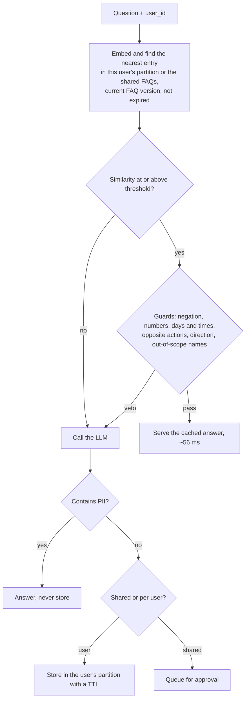

# pakka

**Tests, guards and safety rules for semantic caches, built for English and Hinglish support bots.**

A semantic cache answers a repeat question from memory when its meaning matches an earlier one.
Every gateway ships one now: Redis, Azure, Kong, LiteLLM and others. What none of them tells you is
**how often the cache serves a confident, wrong answer.** Pakka measures that, blocks the common
causes, and keeps the cache from leaking or going stale.

*Pakka* is Hinglish for "sure": *pakka sure hai?*

## The problem, in three numbers from this repo

- **No threshold is safe.** On 526 held-out support questions, a plain cache with its threshold tuned on
  separate data could not keep false hits under 10% at 95% confidence. At best it served 55 right answers
  and 12 wrong ones.
- **Negation fools embeddings.** `I don't want to delete my account, how do I just deactivate it?` matched
  "How do I delete my account?" at 0.88 similarity. So did `coupon apply kyun nahi ho raha?` and "How do I
  apply a coupon code?".
- **Hinglish is barely served.** The spec's multilingual model caught 12 of 200 Hinglish paraphrases.

## What pakka does

| Part | What it is |
|---|---|
| `pakka bench` | Replays a labelled question set through a cache. Reports hit rate and false hits with 95% Wilson intervals, picks the threshold on a dev split and reports on held-out, breaks errors down by trap type and language, and fails CI when the false-hit bound regresses |
| HinglishCacheBench (`data/bench_v1.jsonl`) | 1,059 support questions in English, Hinglish and Hindi with labelled trap questions (negation, entity, number, near intent, personal), written by one LLM, labelled blind by a second, with disagreements settled by a human ([dataset card](data/README.md)) |
| `pakka.guard` | Microsecond rule guards that veto a hit: negation (incl. nahi/nhi/nahin, नहीं), numbers and IDs, days and times (today/kal/आज, am/pm), opposite actions (on/off, buy/sell), swapped direction ("pdf to jpg"), and out-of-scope names. Tested on nine public datasets ([results](docs/public_results.md)) |
| `pakka.policy` + `pakka.pii` | Never stores Indian PII (Aadhaar with checksum, PAN, UPI, +91 mobiles, IFSC, cards, order IDs), keeps each user's answers in their own partition, retires answers when the FAQ changes, expires stored answers, queues shared answers for approval, and supports erasure requests |
| `pakka.testset`, `pakka.train` | Generate a stress-test set for your own FAQ with two LLMs, and fine-tune an embedder on it |
| Dukaan Bot (`examples/dukaan_bot`) | A small FAQ support bot for a fictional Indian store, used as the end-to-end test |

## Results (526 held-out questions, threshold picked on dev)

| Setup | Right answers | Wrong answers | False-hit rate (95% upper bound) | Hinglish caught |
|---|---|---|---|---|
| Plain cache, spec's model, 20% budget | 55 | 12 | 17.9% (28.7%) | 12/200 |
| + pakka guards, 10% budget | 49 | 5 | 9.3% (19.9%) | 11/200 |
| + fine-tuned encoder and approved keys, 10% budget | **70** | **2** | **2.8% (9.6%)** | **32/200** |

In the real bot with a real LLM on the same 526 questions: **13% of questions answered from cache with
2 wrong answers, in 56 ms instead of 1,331 ms.** The set is built to be hard: 35% of it must miss and
55% is Hinglish.

| Safety check | Without pakka | With pakka |
|---|---|---|
| Hits served from before an FAQ edit (persistent cache) | 100% | 0% |
| One user's LLM answer served to another user | yes | never (canary test, in memory and on Redis) |
| A planted answer reaching other users | yes | stays in the attacker's partition |

**Two honest caveats.** Part of the fine-tuning gain is the generator's writing style: on the 46
hand-written held-out questions, paraphrases caught only rose from 11 to 13 of 27. And off-the-shelf
cross-encoder verifiers made every result worse here, so none ships. Every experiment, including
these, is in [docs/results.md](docs/results.md).

## Quickstart

```bash
pip install pakka            # not yet published; until then: pip install -e .
```

Guard a cache you already have:

```python
from pakka.guard import check

check("refund nahi mila", "How long does a refund take?")                    # "negation"
check("Is Cash on Delivery available in Nepal?", "Is Cash on Delivery available?")  # "entity"
check("COD available hai kya?", "Is Cash on Delivery available?")           # None: safe to serve
```

Or use the full flow:

```python
from pakka.cache import NumpyCache            # or pakka.redis_cache.RedisVLCache
from pakka.embed import load_embedder
from pakka.flow import CachedAnswerer
from pakka.guard import check
from pakka.policy import GLOBAL, Policy

def my_llm(question):                         # your LLM call: returns (answer, tokens used)
    ...

cache = NumpyCache(load_embedder("paraphrase-multilingual-MiniLM-L12-v2"))
cache.store("How long does a refund take?", "Refunds take 5-7 business days.",
            {"id": "faq_01", "partition": GLOBAL, "kb_version": "v1"})

bot = CachedAnswerer(cache, my_llm, threshold=0.74, guard=check, policy=Policy(kb_version="v1"))
r = bot.ask("How many days does a refund take?", partition="user-42")
r.hit, r.reason, r.score                      # (True, 'hit', 0.97)
```

Measure your cache:

```bash
pakka bench --data data/bench_v1.jsonl --guard --budget 0.10 \
    --embedder paraphrase-multilingual-MiniLM-L12-v2 --fail-above 0.25
```

## How a question flows



## Run everything

```bash
python3.12 -m venv .venv && .venv/bin/pip install -e ".[redis,bot,dev,train]"
.venv/bin/python -m pytest                                  # unit tests, under a second
docker run -d --name pakka-redis -p 6380:6379 redis:8.2.2-alpine3.22
.venv/bin/python -m pytest -m integration                   # real model + Redis
echo "OPENROUTER_API_KEY=..." > .env                        # for the bot and e2e test
.venv/bin/python -m examples.dukaan_bot.chat --user ravi    # chat with Dukaan Bot
```

More commands (building the benchmark, fine-tuning, the approval queue, the stale-answer demo) are in
[docs/results.md](docs/results.md).

## Limits

PII detection is regex plus checksums and doesn't catch names. Partitions isolate answers but not
timing: a hit is still faster than a miss. `/forget` in the demo bot has no authentication. The
benchmark covers one domain (Indian e-commerce support) with 30 FAQs.

## License

Code: MIT. Dataset: CC BY 4.0.
