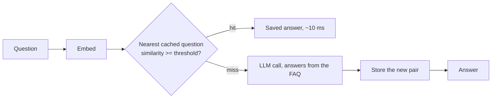

# pakka

Tests, guards and safety rules for semantic caches, so a cache can prove its answers are right.

**Status: phase 0 (baseline).** A plain semantic cache, a reference FAQ bot ("Dukaan Bot") and a
threshold sweep. Guards, the Hinglish benchmark and the safety rules come in later phases.

> **Pilot result:** Cache hit rate 32% on 100 test questions at threshold 0.70 with 2 false hits;
> LLM calls down 32%; average latency down from 1258 ms to 899 ms.
> Hits answer in 27 ms (median) against 1228 ms for an LLM call. Tokens fell from 211k to 144k.
> Measured with Dukaan Bot, paraphrase-multilingual-MiniLM-L12-v2 and anthropic/claude-haiku-5.5 on OpenRouter.



## Quickstart

```bash
python3.12 -m venv .venv && .venv/bin/pip install -e ".[redis,bot,dev]"
.venv/bin/python -m pytest                    # unit tests, no model or network, under a second
.venv/bin/python -m pytest -m integration     # real embedding model + Redis on port 6380
.venv/bin/python -m pakka.bench --embedder paraphrase-multilingual-MiniLM-L12-v2 --thresholds 0.6,0.65,0.7,0.75
```

The bot needs an OpenRouter key in `.env` (`OPENROUTER_API_KEY=...`, gitignored):

```bash
.venv/bin/python -m examples.dukaan_bot.chat                          # chat in the terminal
.venv/bin/uvicorn examples.dukaan_bot.app:create_app --factory         # POST /chat {"question": "..."}
.venv/bin/python -m examples.dukaan_bot.replay --no-cache && .venv/bin/python -m examples.dukaan_bot.replay
.venv/bin/python -m pytest -m e2e                                      # real LLM, costs about $0.001
```

Redis with search for the `redis` backend (`PAKKA_BACKEND=redis`):
`docker run -d --name pakka-redis -p 6380:6379 redis:8.2.2-alpine3.22`

## Tests

| Layer | What runs | When |
|---|---|---|
| Unit | Cache, flow, sweep, bot API, data checks, with a fake embedder and a fake LLM | Every change |
| Integration (`-m integration`) | Real sentence-transformers model; RedisVL scores match numpy within 0.001 | Before each phase ends |
| End to end (`-m e2e`) | Dukaan Bot with the real LLM | Before each phase ends |

## Data

- `data/faqs.json`: 30 FAQs for a fictional Indian online store.
- `data/pilot.jsonl`: 100 labelled questions. 60 paraphrases (30 English, 30 Hinglish) carry the FAQ
  they should match; 40 should miss, tagged `negation`, `personal`, `near_intent`, `entity` or `off_topic`.

## Pilot sweep (100 questions; misses charged an assumed 1,500 ms of LLM time, measured later at about 1,260 ms)

Thresholds don't transfer between models. In the spec's 0.75-0.95 range, the MiniLM models
catch few paraphrases, while multilingual-e5-small lets almost everything through:

| Model | 0.75 | 0.85 | 0.95 |
|---|---|---|---|
| all-MiniLM-L6-v2 | 19% hits, 1 false | 7%, 0 | 4%, 0 |
| paraphrase-multilingual-MiniLM-L12-v2 | 25%, 1 | 12%, 0 | 2%, 0 |
| multilingual-e5-small | 100%, 48 | 70%, 22 | 8%, 1 |

Swept over each model's own range, the best "almost safe" settings were:

| Model | Threshold | Hit rate | Correct hits | False hits | Hinglish paraphrases caught |
|---|---|---|---|---|---|
| **paraphrase-multilingual-MiniLM-L12-v2** | **0.70** | **32%** | **30** | **2** | **8/30** |
| all-MiniLM-L6-v2 | 0.70 | 24% | 22 | 2 | - |
| multilingual-e5-small | 0.91 | 25% | 22 | 3 | 1/30 |

False hits the next phases have to stop:

- `coupon apply kyun nahi ho raha?` was served the answer to "How do I apply a coupon code?" (negation, 0.714)
- `Is Cash on Delivery available in Nepal?` got "Yes, COD is available" from every model (entity)
- `How do I cancel my Netflix subscription?` matched "How do I cancel my order?" on e5-small (near intent)

100 questions is a pilot: one false hit moves the rate by a full point, so these numbers only show
direction. Phase 1 grows the set to about 1,000 and adds confidence intervals.
