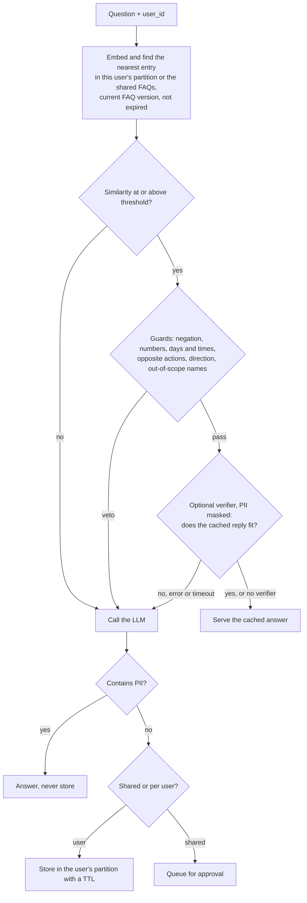

# pakka

**Tests, guards and safety rules for semantic caches, built for English and Hinglish support bots.**

A semantic cache answers a repeat question from memory when its meaning matches an earlier one.
Every gateway ships one now: Redis, Azure, Kong, LiteLLM and others. What none of them tells you is
**how often the cache serves a confident, wrong answer.** Pakka measures that, blocks the common
causes, and keeps the cache from leaking or going stale.

*Pakka* is Hinglish for "sure": *pakka sure hai?*

## The problem, in three numbers from this repo

- **No threshold is safe.** On 526 held-out support questions, a plain cache with its threshold tuned on
  separate data could not keep false hits under 10% at 95% confidence. At best it served 55 right answers
  and 12 wrong ones.
- **Negation fools embeddings.** `I don't want to delete my account, how do I just deactivate it?` matched
  "How do I delete my account?" at 0.88 similarity. So did `coupon apply kyun nahi ho raha?` and "How do I
  apply a coupon code?".
- **Hinglish is barely served.** The spec's multilingual model caught 12 of 200 Hinglish paraphrases.

## What pakka does

| Part | What it is |
|---|---|
| `pakka bench` | Replays a labelled question set through a cache. Reports hit rate and false hits with 95% Wilson intervals, picks the threshold on a dev split and reports on held-out, breaks errors down by trap type and language, and fails CI when the false-hit bound regresses |
| HinglishCacheBench (`data/bench_v1.jsonl`) | 1,059 support questions in English, Hinglish and Hindi with labelled trap questions (negation, entity, number, near intent, personal), written by one LLM, labelled blind by a second, with disagreements settled by a human ([dataset card](data/README.md)) |
| `pakka.guard` | Microsecond rule guards that veto a hit: negation (incl. nahi/nhi/nahin, नहीं), numbers and IDs, days and times (today/kal/आज, am/pm), opposite actions (on/off, buy/sell), swapped direction ("pdf to jpg"), and out-of-scope names. Tested on nine public datasets ([results](docs/public_results.md)) |
| `pakka.verify` | Optional, off by default: a second opinion on hits the guards let through, from TypeSafe's Jev, any OpenRouter model, or your own function. PII is masked first; an error or timeout counts as a miss |
| `pakka.policy` + `pakka.pii` | Never stores Indian PII (Aadhaar with checksum, PAN, UPI, +91 mobiles, IFSC, cards, order IDs), keeps each user's answers in their own partition, retires answers when the FAQ changes, expires stored answers, queues shared answers for approval, and supports erasure requests |
| `pakka.testset`, `pakka.train` | Generate a stress-test set for your own FAQ with two LLMs, and fine-tune an embedder on it |
| Dukaan Bot (`examples/dukaan_bot`) | A small FAQ support bot for a fictional Indian store, used as the end-to-end test |

## Results

Pakka with its guards on, threshold picked on HinglishCacheBench v1's dev split and reported on held-out questions.
Two test sets: v1's 526 LLM-written questions, and 258 messages real people wrote in their own words (80%
romanized Hinglish), which is the harder and more honest one. Cells are right / wrong answers served from cache,
with the 95% upper bound on the false-hit rate. **Default** is MiniLM-L12; Qwen3-0.6B is the option for a GPU.

**Free (no API calls), 10% budget:**

| Embedder | Threshold | v1 test (526) | Human test (258) | Hinglish caught (human) |
|---|---|---|---|---|
| **MiniLM-L12 (default)** | 0.79 | 47 / 5 (20.6%) | 2 / 1 (79.2%) | 0/184 |
| Qwen3-Embedding-0.6B (GPU option) | 0.925 | 102 / 8 (13.7%) | 11 / 0 (25.9%) | 6/184 |

No threshold fits a 5% budget for either embedder without a verifier.

**With an optional verifier** (a second opinion on each hit the guards let through; similarity threshold lowered
to 0.6):

| Embedder + verifier | v1 test (526) | Human test (258) | Hinglish caught (human) | Extra time per checked hit | Cost per 100k checks |
|---|---|---|---|---|---|
| **MiniLM-L12** + cheap LLM (`openrouter:qwen/qwen3.7-flash`, yes / no) | 118 / 6 (10.2%) | 23 / 0 (14.3%) | 12/184 | ~0.9 s | ~$0.60 |
| **MiniLM-L12** + Jev (TypeSafe `jev-1.14.0`, score ≥ 0.84) | 96 / 1 (5.6%) | 19 / 0 (16.8%) | 10/184 | ~0.3 s | ~$1.75 |
| Fine-tuned MiniLM-L12 (opt-in, Phase 9) + Jev (score ≥ 0.84) | 148 / 3 (5.7%) | 54 / 1 (9.6%) | 44/184 | ~0.3 s | ~$1.75 |
| Qwen3-0.6B + cheap LLM | 231 / 13 (8.9%) | 113 / 9 (13.4%) | 97/184 | ~0.9 s | ~$0.60 |
| Qwen3-0.6B + Jev (score ≥ 0.84) | 181 / 3 (4.7%) | 80 / 1 (6.7%) | 67/184 | ~0.3 s | ~$1.75 |

- **A verifier doubles what the default answers on v1** without more wrong answers. On real messages it lifts
  MiniLM from 2 to about 20 answers: most real messages score below 0.6 with MiniLM, so the verifier never sees them.
- **The fine-tuned MiniLM closes most of that gap on a CPU.** With Jev it answers 54 real messages with 1 wrong,
  against 19 for MiniLM and 80 for Qwen3-0.6B, at MiniLM's 9 ms. Without a verifier it is no better than MiniLM.
  See "Choosing an embedder".
- **Qwen3-0.6B with a verifier is the strongest setup**: it answers a third to a half of real messages. It needs a
  GPU or Apple Silicon to stay fast (see below).
- The cheap LLM fits about a 10% budget; Jev gives a score you can tighten, so it also fits 5% on dev. The LLM
  call a hit saves took 1.3 s in the real bot.
- On the public parse datasets (Hinglish-TOP, MASSIVE) Jev cuts false hits, the cheap LLM barely does, and no
  setup fits 5%: see [docs/public_results.md](docs/public_results.md#free-vs-with-a-verifier-phase-85).

Earlier v1 results with MiniLM-L12, including a fine-tuned encoder (526 held-out questions):

| Setup | Right answers | Wrong answers | False-hit rate (95% upper bound) | Hinglish caught |
|---|---|---|---|---|
| Plain cache, spec's model, 20% budget | 55 | 12 | 17.9% (28.7%) | 12/200 |
| + pakka guards, 10% budget | 49 | 5 | 9.3% (19.9%) | 11/200 |
| + fine-tuned encoder and approved keys, 10% budget | **70** | **2** | **2.8% (9.6%)** | **32/200** |

In the real bot with a real LLM on the same 526 questions (MiniLM): 13% of questions answered from cache
with 2 wrong answers, in 56 ms instead of 1,331 ms. The set is built to be hard: 35% of it must miss and
55% is Hinglish.

**At scale, on 4,000 held-out Bitext questions with Bitext's 27 e-commerce answers as the knowledge base** (Phase 10;
every served answer checked by three LLM judges, not by intent labels):

| Setup | Answered from cache | Wrong answers served (95% upper) | Hit time p50 | LLM spend saved, verifier paid |
|---|---|---|---|---|
| **MiniLM-L12 (default), free** | 9.8% | 103 of 394: 26% (31%) | 9 ms | 9.9% |
| Fine-tuned MiniLM + Jev | 30.9% | 187 of 1,236: 15% (17%) | 326 ms | 27.8% |
| Qwen3-0.6B (GPU) + Jev | 38.1% | 254 of 1,525: 17% (19%) | 379 ms | 35.1% |

The LLM itself (1,248 ms p50) got 3–4% of the same questions wrong, so on this traffic the cache is wrong 4–6 times as
often. Most of it comes from a few FAQ answers that only fit their own seed question: Bitext's "cancel order" answer
just says "please ask your question". Lesson: seed a cache with answers that stand on their own. Details,
the cheap-LLM verifier (52% answered, 26% wrong) and a one-command reproduce:
[docs/public_results.md](docs/public_results.md#phase-10-the-real-bot-on-4000-bitext-questions).

| Safety check | Without pakka | With pakka |
|---|---|---|
| Hits served from before an FAQ edit (persistent cache) | 100% | 0% |
| One user's LLM answer served to another user | yes | never (canary test, in memory and on Redis) |
| A planted answer reaching other users | yes | stays in the attacker's partition |

**Honest caveats.** v1 overstated what a cache can answer: its questions were LLM-written, and on real
people's messages the free setup answers a tenth as much or less (the human test above). Part of v1's fine-tuning gain
is the generator's writing style too: on the 46 hand-written held-out questions, paraphrases caught only rose
from 11 to 13 of 27. Off-the-shelf cross-encoder verifiers made every result worse; the verifiers that help
are API calls, so they are optional and off by default. Every experiment is in [docs/results.md](docs/results.md)
and [docs/public_results.md](docs/public_results.md).

## Choosing an embedder

The default is MiniLM-L12: about 9 ms a question on any CPU, which is where most bots run. **If you have a GPU or
Apple Silicon, switch to Qwen3-Embedding-0.6B** for about twice the answers at the same budget:

```python
cache = NumpyCache(load_embedder(GPU_EMBEDDER))   # from pakka.embed import GPU_EMBEDDER; then threshold=0.925
```

In the Dukaan bot that is `PAKKA_EMBEDDER=Qwen/Qwen3-Embedding-0.6B` (the threshold follows). Measured on a MacBook
Air M2, one question at a time, as a lookup embeds it; the CPU rows have the GPU switched off:

| | MiniLM-L12 (default) | Qwen3-Embedding-0.6B (GPU option) |
|---|---|---|
| Download | 0.48 GB | 1.2 GB |
| Memory (process peak) | ~0.7 GB | ~1.0 GB |
| CPU, 8 threads (median / p90) | 9 / 10 ms | 235 / 312 ms |
| CPU, 2 threads, like a small VPS (median / p90) | 8 / 8 ms | 538 / 834 ms |
| M2 GPU (median) | ~9 ms | ~36 ms |
| Threshold, guards on (`pakka.embed.THRESHOLDS`) | 0.79 | 0.925 |
| v1 test, free, 10% budget | 47 / 5 | 102 / 8 |
| Human test, free, 10% budget | 2 / 1 | 11 / 0 |

**On a CPU with a verifier, try the fine-tuned MiniLM** (`TUNED_EMBEDDER`, Phase 9). It has the same size and
speed as MiniLM (9 ms a question on 8 CPU threads), and with a verifier it answers about three times as many real
messages: 19 → 54 with Jev, 1 wrong. Fine-tuning lifts real messages above the verifier's 0.6 floor (165 of 258
instead of 26); the verifier then sorts them. **Without a verifier it doesn't help** (2 / 1 → 9 / 2 on real
messages, worse on CLINC150), so keep the default then. Trained on public dev and train splits only and measured on
data it never saw: [model card](docs/model_card_minilm_hinglish.md).

```python
cache = NumpyCache(load_embedder(TUNED_EMBEDDER))  # from pakka.embed import TUNED_EMBEDDER; threshold=0.6 + verify=
```

In the Dukaan bot: `PAKKA_EMBEDDER=mohd010/pakka-minilm-l12-hinglish PAKKA_VERIFY=jev` (or
`PAKKA_VERIFY=openrouter:<model>`); the threshold drops to 0.6 when a verifier is on.

Mean P-CHR AUC over the public datasets: 0.571 for MiniLM, 0.647 for Qwen3-0.6B. A threshold belongs to one
embedder; for any other model, pick one with `pakka bench --embedder <model>`.

## Quickstart

```bash
pip install pakka            # not yet published; until then: pip install -e .
```

Guard a cache you already have:

```python
from pakka.guard import check

check("refund nahi mila", "How long does a refund take?")                    # "negation"
check("Is Cash on Delivery available in Nepal?", "Is Cash on Delivery available?")  # "entity"
check("COD available hai kya?", "Is Cash on Delivery available?")           # None: safe to serve
```

Or use the full flow:

```python
from pakka.cache import NumpyCache            # or pakka.redis_cache.RedisVLCache
from pakka.embed import load_embedder
from pakka.flow import CachedAnswerer
from pakka.guard import check
from pakka.policy import GLOBAL, Policy

def my_llm(question):                         # your LLM call: returns (answer, tokens used)
    ...

cache = NumpyCache(load_embedder())          # MiniLM-L12; Qwen3-0.6B with a GPU (see above)
cache.store("How long does a refund take?", "Refunds take 5-7 business days.",
            {"id": "faq_01", "partition": GLOBAL, "kb_version": "v1"})

bot = CachedAnswerer(cache, my_llm, threshold=0.79, guard=check, policy=Policy(kb_version="v1"))
r = bot.ask("How many days does a refund take?", partition="user-42")
r.hit, r.reason, r.score                      # (True, 'hit', 0.968)
```

Measure your cache:

```bash
pakka bench --data data/bench_v1.jsonl --guard --budget 0.10 --fail-above 0.25
```

## Turn on a verifier (optional)

Off by default: pakka works fully offline without one. A verifier is asked one question about each hit the
guards let through, "would the reply for the cached question also answer this one?", and the hit is served only
on a yes. Since it catches what similarity misses, lower the threshold to 0.6 so it sees the grey band:

```python
from pakka.verify import load_verifier

bot = CachedAnswerer(cache, my_llm, threshold=0.6, guard=check, policy=Policy(kb_version="v1"),
                     verify=load_verifier("openrouter:qwen/qwen3.7-flash"))   # needs OPENROUTER_API_KEY
# or verify=load_verifier("jev")              TypeSafe's Jev, needs TYPESAFE_API_KEY, passes at score 0.84
# or verify=my_check                          any function (question, cached_question, cached_answer) -> bool
```

- `pip install "pakka[verify]"` adds the HTTP client.
- The verifier only ever sees text masked with `pakka.pii.mask` (Aadhaar, PAN, phone numbers, order IDs and so on).
- One try with a 5-second timeout (`load_verifier(..., timeout=)`). An error or a timeout counts as a miss, so the
  LLM answers and no unchecked hit is served. `Result.reason` says `blocked:verify` or `blocked:verify_error`.
- Any OpenRouter chat model works after `openrouter:`; `qwen/qwen3.7-flash` was the cheapest of five tried, and
  as accurate. Measure your own pick before trusting it:

```bash
pakka bench --data data/bench_v1.jsonl --guard --budget 0.05 --verify jev-1.14.0 --verify openrouter:qwen/qwen3.7-flash
```

## How a question flows



## Run everything

```bash
python3.12 -m venv .venv && .venv/bin/pip install -e ".[redis,bot,dev,train,verify]"
.venv/bin/python -m pytest                                  # unit tests, under a second
docker run -d --name pakka-redis -p 6380:6379 redis:8.2.2-alpine3.22
.venv/bin/python -m pytest -m integration                   # real model + Redis
echo "OPENROUTER_API_KEY=..." > .env                        # for the bot and e2e test
.venv/bin/python -m examples.dukaan_bot.chat --user ravi    # chat with Dukaan Bot
```

More commands (building the benchmark, fine-tuning, the approval queue, the stale-answer demo) are in
[docs/results.md](docs/results.md).

## Limits

Qwen3-Embedding-0.6B, the GPU option, takes a quarter to half a second per question on a CPU. With the default
MiniLM-L12, most real people's messages score below a verifier's 0.6 floor, so a verifier helps it less. PII detection is regex plus checksums and doesn't catch names, so a verifier can see a name. Partitions isolate answers but not
timing: a hit is still faster than a miss. `/forget` in the demo bot has no authentication. The
benchmark covers one domain (Indian e-commerce support) with 30 FAQs.

## License

Code: MIT. Dataset: CC BY 4.0.
