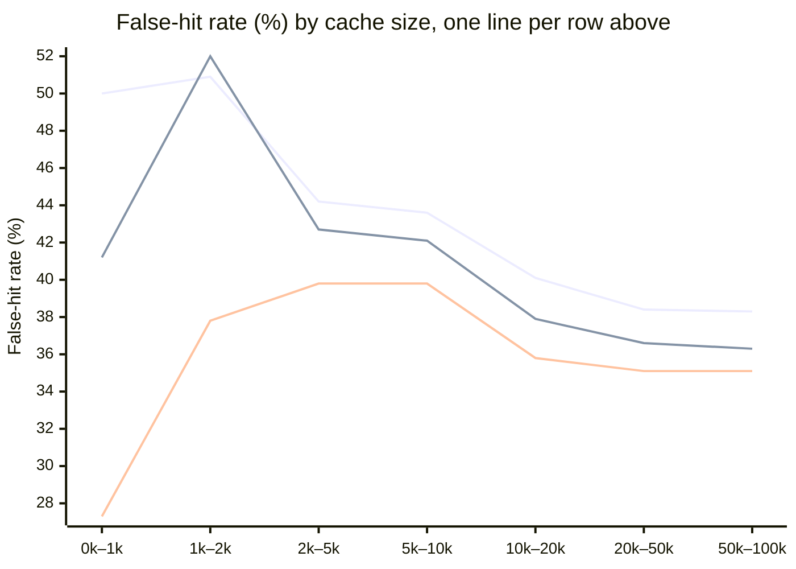

# Public benchmark results

Until now every pakka number came from our own 1,059 LLM-written questions on 30 FAQs. This page runs the same
cache, with and without pakka's guards, on **nine public datasets that other people built and labelled**: about
420,000 questions and sentence pairs in English, Hindi and Hinglish. It compares ten embedders on all of it
(eight local, two through an API), including the one RedisVL uses by default at RedisVL's default threshold.
Measured 2–3 Nov 2026 on a MacBook Air M2 with 8 GB.
Phase 7 (same day) fixed the guards using dev splits only, re-ran everything, gave LangCache a stratified dev/test
split, and had three LLMs audit 1,455 sampled hits to measure how often the labels themselves are wrong. The audit
led to one label fix: MASSIVE Hindi questions whose slot value is only translated are now hits, not traps (see
"How each dataset becomes a cache test"), and every MASSIVE number here uses the fixed labels.

## What we found

1. **There is no safe universal threshold.** RedisVL's defaults (`langcache-embed-v1` at similarity 0.90) serve
   more than 5% wrong answers on 6 of 10 datasets: 66% on Hinglish-TOP, 46% on MASSIVE, 35% on vCache
   SearchQueries, 24% on LangCache's own pairs. A threshold picked on one dataset and applied to another breaks
   the budget in most cells of the transfer matrix (0.909 from Banking77 gives 73% false hits on Hinglish-TOP).
   It doesn't carry across embedders either: the e5 models' dev-picked thresholds sit between 0.94 and 0.98,
   where MiniLM's sit between 0.81 and 0.96.
2. **Picking the threshold on a dev split works, when dev looks like the traffic.** On Banking77, CLINC150,
   Bitext and vCache Classification the dev-picked threshold held on test: 1.4% to 4.5% false hits with MiniLM,
   and at worst 6.0% across all ten embedders (Qwen3-Embedding-8B on CLINC150). On LangCache it failed:
   validation has no QQP, PAWS or APT pairs, and test false hits came out at 25–40% for nine embedders and 19% for
   `langcache-embed-v1`. With a stratified dev split instead (a fifth of each source in LangCache test), **no
   threshold fits for any embedder**: even the 5% of pairs each one scores highest are 7–32% wrong (Qwen3-8B
   lowest). The method then says so up front, instead of picking a threshold that fails on test.
3. **On half the datasets nothing fits a 5% budget at all,** for any of the ten embedders: our own set,
   Hinglish-TOP, MASSIVE, stratified LangCache, vCache LmArena and SearchQueries. Similarity alone can't separate
   "alarm 6 baje" from "alarm 7 baje", "switch on the lights" from "switch off the lights", or "convert jpg to pdf"
   from "convert pdf to jpg". For traffic like that, a semantic cache needs more than a threshold. (Part of this is label noise:
   see the label audit.)
4. **The cache-size curve is about volume, not ratio.** On SearchQueries at 0.90 the share of hits that are wrong
   doesn't climb as the cache grows from 1k to 100k entries (it moves within 27–51% and settles near 35–38%),
   but the hit rate climbs from 1–2% to about 60%. So wrong answers per 100 questions go from 0.3–1 to 21–23.
5. **A better embedder is the biggest lever, but it doesn't remove the traps.** Qwen3-Embedding-8B (through an
   API) has the best AUC on six of the eight threshold-free rows: mean 0.699, against 0.647 for Qwen3-Embedding-0.6B,
   the best local model and pakka's option for a GPU, and 0.571 for MiniLM, pakka's default. On our own
   set at a 10% budget with guards it answers 188 of 526 held-out questions with 14 wrong, where MiniLM answers 48 with 5 wrong. But no embedder,
   Qwen3-8B included, fits a 5% budget on our set, Hinglish-TOP, MASSIVE, LmArena, SearchQueries or stratified
   LangCache. Through an API it is slow, too: one question took 1.5 s to embed at the median (p90 19 s), as long as
   the LLM call a cache is meant to skip. Its small sibling Qwen3-Embedding-0.6B runs on the laptop's GPU in 36 ms
   (235 ms on its CPU) and, with guards, answers 101 of our questions with 7 wrong. OpenAI's text-embedding-3-small, a common default, is no
   better than MiniLM on our set and nearly blind to Hindi (MASSIVE AUC 0.266). See "Better embedders" below.
6. **Labels are part of the problem.** Three LLM judges overturn about a third of vCache SearchQueries hit labels
   and call 68% of LmArena's labelled false hits fine. Intent datasets (Banking77, CLINC150, Bitext) label
   intent, not answers, so 39–52% of their "correct" hits would serve the wrong answer by the judges' strict reading.
   Our own set's labels held up best.
7. **A verifier on grey-band hits is a bigger lever still, and it is optional.** On 258 messages real people
   wrote, Qwen3-0.6B + guards answers 11 for free; with a cheap OpenRouter LLM checking each hit it answers 113
   with 9 wrong, and with TypeSafe's Jev 80 with 1 wrong at a 5% budget. The default MiniLM goes from 2 to about
   20. See "Free vs with a verifier" below.
8. **Fine-tuning MiniLM helps only with a verifier (Phase 9).** Trained on public dev and train splits and
   measured on data it never saw, it is no better free (human test AUC 0.603 → 0.589) and worse on CLINC150. With
   Jev it answers 54 of 258 real messages with 1 wrong, against 19 for base MiniLM and 80 for Qwen3-0.6B, at MiniLM's
   CPU speed. See "Phase 9: fine-tuning MiniLM-L12" below.

### Where pakka loses

- **Guards still trade a few hits on intent-labelled data.** Phase 7 cut the good hits they throw away (MiniLM,
  held-out: vCache Classification 4,076 → 106, LangCache 740 → 312), but at the same 5% budget guards still lower
  the hit rate in 36 of the 46 cases where a threshold fits (ten embedders) and raise it in 9. The drops are small
  now: a median of 0.3 points, the worst 4.2 (Qwen3-Embedding-8B on LangCache). In Phase 6 the average drop was 2.4
  points and the worst 10.9. Most of what's left are slot vetoes the labels call wrong
  ("set the timer for 10 minutes" served the answer to "a 4 minute timer"; bill #00108 vs #85632), and the audit's
  judges back most of those vetoes. On LmArena and LangCache the remaining vetoes are mostly wrong.
- **Guards don't make the hard datasets fit a 5% budget.** On Hinglish-TOP, MASSIVE, LmArena, SearchQueries and
  stratified LangCache nothing fits, with or without guards. At the same hit rate guards do cut false hits,
  most on Hinglish-TOP (MiniLM's top tenth: 73.8% plain, 66.2% Phase 6 guards, 63.7% now).
- **Phase 6's clearest guard win was luck.** Guards cut RedisVL-default false hits on Bitext from 4.0% to 0.8%
  because one seed question, "i dont know what i need to do to download my bill", read as a negation and blocked
  "check my bill" questions along with good hits. Phase 7 reads "don't know" as a hedge, which is right, and that
  win is gone (4.1%).
- **Guards misread real people's Hinglish.** On 258 messages written by people (Phase 8), 39 of Qwen3's 82
  guard vetoes threw away a right answer, 31 of them negation: "abhi ship nahi hua na, cancel karna hai" uses
  "nahi" to describe the problem. Phase 8's negation fix brings that to 26 of 63 (18 negation), but guards
  still lower ranking quality on real messages. A Jev verifier recovers most of the lost hits; see
  "Human-written Hinglish" below.
- **Guards got slower:** about 60 µs per check, up from 35 µs. Still far below an embedding lookup.
- **pakka's default embedder isn't the strongest.** Qwen3-Embedding-0.6B doubles what the cache can answer on our
  set at the same budget (Qwen3-Embedding-8B nearly quadruples it). MiniLM-L12 stays the default because most bots
  run on CPUs: it takes about 9 ms a question there, Qwen3-0.6B 235 ms with 8 threads and 538 ms with 2. With a
  GPU or Apple Silicon, switch to Qwen3-0.6B (threshold 0.925).
- **On our own HinglishCacheBench nothing fits a 5% budget** with any embedder (v1 needed 10–20%).
- **Where pakka helps:** guards catch the structural traps a threshold can't: day and time swaps, on/off,
  direction ("pdf to jpg"), numbers. They cut RedisVL-default false hits on Hinglish-TOP from 65.8% to 61.4%, and
  the judges back 112 of the 166 audited vetoes that the labels call wrong. `pakka bench`'s dev-split method finds a
  threshold that holds when one exists, and says plainly when none does.

## Free vs with a verifier (Phase 8.5)

Pakka with guards, on the four sets the Jev verifier was measured on: Qwen3-Embedding-0.6B (the GPU option) on all
four, MiniLM-L12 (the default) on our two. **Free** calls no API. **With a verifier**, every hit at similarity 0.6 or more that the guards let through is checked by
one more model, "would the reply for the cached question also answer this one?", and served only on a yes. Both
verifiers see PII-masked text, as `CachedAnswerer(verify=...)` sends it. Thresholds are picked on dev (v1 dev for the
human test) and reported on test. Cells: right / wrong served from cache (false-hit rate, 95% upper bound).

Qwen3-Embedding-0.6B:

| Held-out set | Free: guards | + cheap LLM (`qwen/qwen3.7-flash`, yes / no) | + Jev (`jev-1.14.0`) |
|---|---|---|---|
| v1 test (526), 10% budget | 102 / 8 (7.3%, 13.7%) | 231 / 13 (5.3%, 8.9%) | 236 / 16 (6.3%, 10.1%) |
| v1 test, 5% budget | none fits | none fits | 181 / 3 (1.6%, 4.7%) |
| Human test (258), 10% budget | 11 / 0 (0.0%, 25.9%) | 113 / 9 (7.4%, 13.4%) | 106 / 14 (11.7%, 18.6%) |
| Human test, 5% budget | none fits | none fits | 80 / 1 (1.2%, 6.7%) |
| Hinglish-TOP: false hits among the top 5% of held-out | 39.0% | 37.0% | 11.5% |
| MASSIVE en+hi: false hits among the top 5% of held-out | 35.6% | 35.8% | 25.3% |

MiniLM-L12 (default), at the library's settings (free threshold 0.79; with a verifier, similarity 0.6 and Jev
passing at 0.84, which fits 5% on dev for both embedders; with MiniLM alone dev would pick 0.63: 106 / 2 on v1):

| Held-out set | Free: guards | + cheap LLM | + Jev |
|---|---|---|---|
| v1 test (526) | 47 / 5 (9.6%, 20.6%) | 118 / 6 (4.8%, 10.2%) | 96 / 1 (1.0%, 5.6%) |
| Human test (258) | 2 / 1 (33.3%, 79.2%) | 23 / 0 (0.0%, 14.3%) | 19 / 0 (0.0%, 16.8%) |

With MiniLM most real messages score below the 0.6 floor, so a verifier never sees them: it lifts real-message
answers from 2 to about 20, where with Qwen3 it reaches 80–113. Lowering the floor for MiniLM was not tried.

On Hinglish-TOP and MASSIVE nothing fits a 5% budget, free or verified; Phase 8 found the false hits left after Jev
are mostly label artifacts.

- **Jev gives a score, the cheap LLM only yes or no.** So Jev can be tightened to a 5% budget (passing at 0.84)
  and the LLM can't: it has one operating point, about a 10% budget. There it is as good as Jev or better (human
  test: 113 right, 9 wrong, against 106 and 14).
- **On the public parse datasets the cheap LLM barely moves the number.** Near the top of the similarity ranking it
  says yes to most pairs (688 of the top 800 on MASSIVE), so its top 5% is nearly the free one. In a hand read of
  10 sampled yes-but-labelled-wrong pairs per set, about 7 or 8 of each 10 are the same request that the parse
  labels split ("Set alarm for 7 am" / "Set a wakeup alarm for 7 am", "delete all my calendar events" / "delete
  all events from calendar"); the rest are real misses ("turn off my alarm" / "... for this evening"). So here
  the number mostly measures label noise.
- **Cost and time per checked hit.** Jev: about 300 ms and $0.0000175 (413 input tokens). `qwen/qwen3.7-flash`
  through OpenRouter: about 900 ms from India and about $0.000006. The LLM call a hit saves took 1,331 ms in the
  real bot.
- **Which cheap LLM.** Five were tried on 60 v1 dev grey-band pairs (30 right hits, 30 wrong): `qwen/qwen3.7-flash`
  kept 27 / caught 27, `google/gemini-2.5-flash-lite` 26 / 27, `openai/gpt-4.1-nano` 26 / 28,
  `mistralai/mistral-small-3.2-24b-instruct` 28 / 23, `deepseek/deepseek-v4.1-flash` 29 / 26. Qwen3.7-flash was the
  cheapest ($0.03 per million input tokens) and as accurate, so it was measured. Any OpenRouter model can be
  plugged in; measure it the same way first.
- The MASSIVE cell for the cheap LLM asks only as far down the similarity ranking as its top 5% needs (800
  pairs), since a yes / no verifier can't fit 5% anyway. Every other cell checks every grey-band pair.
- Phase 8.5 spent $0.08 on OpenRouter (pilot and all runs); Jev answers came from Phase 8's cache.

Reproduce (needs both keys; answers are cached in `data/public/emb/jev/` and `data/public/emb/openrouter/`):

```bash
(jq -c 'select(.split=="dev")' data/bench_v1.jsonl; jq -c 'select(.split=="test")' data/bench_human.jsonl) > data/public/human_eval.jsonl
for f in data/bench_v1.jsonl data/public/human_eval.jsonl; do for b in 0.05 0.10; do
  pakka bench --data $f --guard --budget $b --verify jev-1.14.0 --verify openrouter:qwen/qwen3.7-flash --embed-cache data/public/emb
done; done
```

## Reproduce

```bash
.venv/bin/python scripts/public_bench.py
```

That one command downloads the datasets from pinned Hugging Face revisions into `data/public/` (gitignored; we
never commit them), embeds every text once per model (cached in `data/public/emb/`), runs every measurement
(cached in `data/public/results/`), and rewrites the tables below. Six of the models took about 3 hours of
compute on a MacBook Air M2 with 8 GB (MiniLM about 10 minutes, each base-size model about 40); bge-m3 took about 1¾ hours on the Mac (16 minutes on a Kaggle T4), and
Qwen3-Embedding-0.6B about 3½ hours for LangCache and the three streams alone (about 40 texts a second).
The two API embedders (`openrouter:qwen/qwen3-embedding-8b` and `openrouter:openai/text-embedding-3-small`) need
`OPENROUTER_API_KEY` in `.env` and cost about $0.70 together for every dataset. After that a rerun takes seconds.
`scripts/public_bench.py <model> ...` measures just those models and redraws the tables from everything measured
so far. Delete `data/public/results/` to measure again after changing pakka;
after changing only the guards, drop the `"guards"` key from each result file and delete the `+guards` files, and
only those get measured again (about 2 minutes per model).

The label audit (needs `OPENROUTER_API_KEY` in `.env`; about $0.10 the first time, free after, since the sample
and every reply are kept in `data/public/audit/`):

```bash
.venv/bin/python scripts/label_audit.py
```

One dataset with the usual CLI:

```bash
.venv/bin/python scripts/fetch_public.py banking77
.venv/bin/pakka bench --data data/public/banking77.jsonl --faqs data/public/banking77.faqs.json --guard \
    --embedder paraphrase-multilingual-MiniLM-L12-v2 --embed-cache data/public/emb
```

## Datasets

| Dataset | Written by | Protocol | Rows (dev / test) | Should hit | Must miss |
|---|---|---|---|---|---|
| [Banking77](https://huggingface.co/datasets/PolyAI/banking77) | People | FAQ, 77 intents | 9,895 / 3,051 | every row: its intent's FAQ | none, so every false hit is a near-intent mix-up |
| [CLINC150](https://huggingface.co/datasets/clinc/clinc_oos) (plus) | People | FAQ, 150 intents | 3,100 / 5,494 | 7,494 in-scope questions | 1,100 out-of-scope questions |
| [Bitext](https://huggingface.co/datasets/bitext/Bitext-customer-support-llm-chatbot-training-dataset) | Generated by Bitext | FAQ, 27 support intents | 11,988 / 12,057 | every row | none |
| [Hinglish-TOP](https://huggingface.co/datasets/WillHeld/hinglish_top) (human split) | People | FAQ, 2,237 parses | 3,782 / 13,243 | 6,124: same parse, English or Hinglish | 8,159 slot traps, 2,742 uncovered |
| [MASSIVE](https://huggingface.co/datasets/AmazonScience/massive) en-US + hi-IN | People | FAQ, 6,237 parses | 12,275 / 13,769 | 19,232: same parse, English or Hindi | 5,153 slot traps, 1,659 uncovered |
| [LangCache sentence pairs](https://huggingface.co/datasets/redis/langcache-sentencepairs-v1) | Mostly people | pairs, 8 sources | 8,405 / 62,021 | 30,035 same-meaning pairs | 40,391 different pairs |
| [vCache LmArena](https://huggingface.co/datasets/vCache/SemBenchmarkLmArena) | Real prompts, LLM variants | stream, 3,500 classes | 12,759 / 51,037 | same class | other class |
| [vCache Classification](https://huggingface.co/datasets/vCache/SemBenchmarkClassification) | Real items, LLM answers | stream, 34 answers | 9,000 / 36,000 | same one-word answer | other answer |
| [vCache SearchQueries](https://huggingface.co/datasets/vCache/SemBenchmarkSearchQueries) | Real search queries, LLM-judged classes | stream, 54,804 classes | 30,000 / 120,000 | same class | other class |
| [HinglishCacheBench v1](../data/README.md) (ours) | LLM, two-LLM labels, human review | FAQ, 30 FAQs | 533 / 526 | 678 | 381 traps and off-topic |

## How each dataset becomes a cache test

- **FAQ protocol** (`pakka bench`, unchanged from v1). The cache is seeded with one question per answer; every
  other question should hit the right one or miss. For intent datasets the first training question of each
  intent is its FAQ. For Hinglish-TOP and MASSIVE the labels come from the human semantic parses: each distinct
  training parse (intent plus slot values, filler words ignored) becomes an FAQ with its English text. A
  question with exactly that parse should hit it, including the seed's own Hinglish or Hindi translation. A
  question with the same intent but different slot values ("alarm 6 baje" vs "alarm 7 baje") is a **slot
  trap** and must miss. Catch-all intents whose slots don't say what is asked (MASSIVE `general_quirky`,
  `qa_factoid`, `qa_maths`, `social_post`; Hinglish-TOP `UNSUPPORTED_*`) only match their own translation.
  MASSIVE Hindi rows whose slot value was localized (Boston became Mumbai) are traps, not hits. MASSIVE's
  "localized" flag is unreliable, though: it marks plain translations ("सुबह पांच बजे" for "five am", "टैक्सी" for
  "taxi") and often sits on the wrong slot of a row. So in a row flagged as localized, every slot not flagged as a
  translation is compared with the English value. It is the same value if it is identical, sounds the same
  (consonants match across scripts: "boston" and "बोस्टन", "new delhi" and "नई दिल्ली"), or is a translation
  MASSIVE's translators gave for that value at least twice and for at least two thirds of that Hindi value's uses
  ("राम" stands in for John, Bob and Sam alike, so it doesn't count). Only a row with a value that is different
  becomes a trap.
- **Stream protocol** (new, `replay_stream`). Questions arrive in the dataset's order. The cache serves the most
  similar stored question's answer if it clears the threshold; every miss is stored, so the cache grows to
  tens of thousands of entries. A hit is right if both questions share the dataset's equivalence class. The
  first fifth of the stream is dev (threshold picked there), the rest is reported with the cache it built.
- **Pairs protocol** (new, `pair_rows`). Two sentences and a same/different label. A pair scoring above the
  threshold is a hit, and a false hit if it's labelled different. Dev is the validation split, test is test. A
  second split, "LangCache pairs, stratified split", reuses only the test pairs: a fifth of each source (chosen
  by an md5 hash of the text, so it never changes) is dev, the rest is test.
- Thresholds are picked on dev so the false-hit rate's 95% Wilson upper bound stays under 5%, and reported on
  test, exactly as v1 does. Guards are `pakka.guard.check`. Phase 6 used them as tuned on our own set; Phase 7
  changed them after reading these datasets' dev splits only (see below). No threshold or rule was tuned on a test
  split.
- Every model sees at most 128 tokens per text (MiniLM's own limit), so long LmArena prompts are cut the same way
  for everyone.

<!-- generated by scripts/public_bench.py: start -->
## Main table

Held-out (test) split of each dataset. Each cell is **false-hit rate · hit rate**. "RedisVL defaults" is `redis/langcache-embed-v1` at similarity 0.9 (RedisVL 0.29's out-of-the-box semantic cache), no tuning. "Tuned" picks the threshold on the dev split so the false-hit rate's 95% upper bound stays under 5%, then reports test. LangCache is pairs: hit rate there is the share of pairs scored as the same.

| Dataset | Protocol | Held-out | RedisVL defaults | RedisVL defaults + pakka guards | MiniLM-L12 (pakka default), tuned | … + guards | Best measured embedder, tuned + guards |
|---|---|---|---|---|---|---|---|
| HinglishCacheBench v1 (ours) | faq | 526 | 0.0% · 2% | 0.0% · 2% | no threshold fits | no threshold fits | no threshold fits |
| Banking77 | faq | 3,051 | 4.2% · 3% | 4.4% · 3% | 4.4% · 3% | 4.5% · 3% | Qwen3-Embedding-0.6B (pakka GPU option): 5.0% · 9% |
| CLINC150 | faq | 5,494 | 1.0% · 4% | 1.0% · 4% | 4.1% · 9% | 4.5% · 8% | Qwen3-Embedding-8B (API): 6.1% · 25% |
| Bitext | faq | 12,057 | 4.0% · 5% | 4.1% · 5% | 1.4% · 2% | 0.6% · 1% | Qwen3-Embedding-8B (API): 4.6% · 22% |
| Hinglish-TOP | faq | 13,243 | 65.8% · 8% | 61.4% · 7% | no threshold fits | no threshold fits | no threshold fits |
| MASSIVE en+hi | faq | 13,769 | 46.0% · 8% | 45.3% · 7% | no threshold fits | no threshold fits | no threshold fits |
| LangCache pairs | pairs | 62,021 | 24.3% · 42% | 24.6% · 38% | 35.6% · 22% | 34.9% · 22% | e5-base: 33.4% · 28% |
| LangCache pairs, stratified split | pairs | 49,618 | 24.3% · 42% | 24.7% · 37% | no threshold fits | no threshold fits | no threshold fits |
| vCache LmArena | stream | 51,037 | 7.4% · 90% | 7.3% · 90% | no threshold fits | no threshold fits | no threshold fits |
| vCache Classification | stream | 36,000 | 9.4% · 31% | 9.7% · 31% | 2.4% · 22% | 2.4% · 22% | OpenAI 3-small (API): 3.7% · 25% |
| vCache SearchQueries | stream | 120,000 | 35.1% · 54% | 34.9% · 54% | no threshold fits | no threshold fits | no threshold fits |

Label-noise floor of the streams: an exact-match cache (same text after lowercasing) replayed over the whole stream is already "wrong" on vCache LmArena 871 of 9,778 hits (8.9%); vCache Classification 6 of 6,356 hits (0.1%); vCache SearchQueries 102 of 680 hits (15.0%), because identical prompts sit in different equivalence classes. No embedder can beat that floor on these labels.


## Embedders, threshold-free: P-CHR AUC

Area under precision vs cache-hit ratio (higher is better), plain cache, held-out split. It doesn't depend on any threshold, so it compares embedders fairly. Streams have none: what a stream stores depends on the threshold.

| Dataset | MiniLM-L12 (pakka default) | langcache-embed-v1 | e5-small | e5-base | IndicSBERT | LaBSE | Qwen3-Embedding-0.6B (pakka GPU option) | bge-m3 | Qwen3-Embedding-8B (API) | OpenAI 3-small (API) |
|---|---|---|---|---|---|---|---|---|---|---|
| HinglishCacheBench v1 (ours) | 0.650 | 0.600 | 0.639 | 0.641 | 0.690 | 0.657 | 0.776 | 0.705 | **0.844** | 0.646 |
| Banking77 | 0.643 | 0.663 | 0.572 | 0.597 | 0.532 | 0.506 | 0.731 | 0.727 | **0.790** | 0.705 |
| CLINC150 | 0.722 | 0.716 | 0.675 | 0.710 | 0.575 | 0.592 | 0.796 | 0.736 | **0.845** | 0.798 |
| Bitext | 0.721 | 0.856 | 0.678 | 0.725 | 0.670 | 0.676 | 0.862 | 0.843 | **0.900** | 0.827 |
| Hinglish-TOP | 0.183 | 0.200 | 0.199 | 0.187 | 0.316 | 0.218 | 0.315 | 0.237 | **0.374** | 0.218 |
| MASSIVE en+hi | 0.447 | 0.240 | 0.361 | 0.369 | 0.449 | 0.473 | 0.417 | 0.455 | **0.495** | 0.266 |
| LangCache pairs | 0.602 | **0.677** | 0.592 | 0.603 | 0.617 | 0.579 | 0.640 | 0.626 | 0.672 | 0.614 |
| LangCache pairs, stratified split | 0.601 | **0.677** | 0.591 | 0.602 | 0.616 | 0.578 | 0.639 | 0.625 | 0.671 | 0.613 |
| Mean | 0.571 | 0.579 | 0.538 | 0.554 | 0.558 | 0.535 | 0.647 | 0.619 | 0.699 | 0.586 |

## Embedders at a 5% false-hit budget, with guards

Hit rate on held-out at the dev-picked threshold, with the held-out false-hit rate in brackets: above 5% means the threshold picked on dev didn't hold.

| Dataset | MiniLM-L12 (pakka default) | langcache-embed-v1 | e5-small | e5-base | IndicSBERT | LaBSE | Qwen3-Embedding-0.6B (pakka GPU option) | bge-m3 | Qwen3-Embedding-8B (API) | OpenAI 3-small (API) |
|---|---|---|---|---|---|---|---|---|---|---|
| HinglishCacheBench v1 (ours) | none fits | none fits | none fits | none fits | none fits | none fits | none fits | none fits | none fits | none fits |
| Banking77 | 3% (4.5%) | 3% (5.2%) | 3% (3.5%) | 3% (3.5%) | 1% (3.2%) | 1% (0.0%) | **9%** (5.0%) | 3% (1.9%) | 3% (1.2%) | 7% (4.9%) |
| CLINC150 | 8% (4.5%) | none fits | none fits | 3% (2.8%) | none fits | none fits | 10% (4.7%) | 5% (3.6%) | **25%** (6.1%) | 7% (3.1%) |
| Bitext | 1% (0.6%) | 19% (4.5%) | 1% (0.0%) | 7% (5.7%) | 5% (3.9%) | 4% (3.7%) | 11% (3.7%) | 19% (4.7%) | **22%** (4.6%) | 8% (4.3%) |
| Hinglish-TOP | none fits | none fits | none fits | none fits | none fits | none fits | none fits | none fits | none fits | none fits |
| MASSIVE en+hi | none fits | none fits | none fits | none fits | none fits | none fits | none fits | none fits | none fits | none fits |
| LangCache pairs | 22% (34.9%) | 17% (23.1%) | 26% (34.9%) | **28%** (33.4%) | 27% (32.9%) | 20% (39.1%) | 25% (29.3%) | 26% (31.4%) | 27% (23.6%) | 13% (31.2%) |
| LangCache pairs, stratified split | none fits | none fits | none fits | none fits | none fits | none fits | none fits | none fits | none fits | none fits |
| vCache LmArena | none fits | none fits | none fits | none fits | none fits | none fits | none fits | none fits | none fits | none fits |
| vCache Classification | 22% (2.4%) | 21% (2.6%) | 23% (2.7%) | 24% (3.0%) | 21% (2.0%) | 22% (2.4%) | 23% (2.6%) | 22% (1.8%) | 21% (2.1%) | **25%** (3.7%) |
| vCache SearchQueries | none fits | none fits | none fits | none fits | none fits | none fits | none fits | none fits | none fits | none fits |

## Do guards help on data they weren't designed for? (MiniLM-L12 (pakka default))

Same budget, threshold picked on dev with and without guards. "Plain at the same hit rate" is the plain cache's held-out false-hit rate if it served as many questions as the guarded one did.

| Dataset | Plain, tuned | Guards, tuned | Plain at the same hit rate | Good hits vetoed | Vetoes by rule |
|---|---|---|---|---|---|
| HinglishCacheBench v1 (ours) | no threshold fits | no threshold fits | - | - | - |
| Banking77 | 4.4% · 3% | 4.5% · 3% | 4.5% | 2 | direction 1, entity 1 |
| CLINC150 | 4.1% · 9% | 4.5% · 8% | 4.0% | 43 | negation 12, slot 31 |
| Bitext | 1.4% · 2% | 0.6% · 1% | 0.0% | 13 | slot 13 |
| Hinglish-TOP | no threshold fits | no threshold fits | - | - | - |
| MASSIVE en+hi | no threshold fits | no threshold fits | - | - | - |
| LangCache pairs | 35.6% · 22% | 34.9% · 22% | 35.6% | 312 | action 4, direction 46, entity 415, negation 41, slot 127 |
| LangCache pairs, stratified split | no threshold fits | no threshold fits | - | - | - |
| vCache LmArena | no threshold fits | no threshold fits | - | - | - |
| vCache Classification | 2.4% · 22% | 2.4% · 22% | - | 106 | entity 22, negation 13, slot 75 |
| vCache SearchQueries | no threshold fits | no threshold fits | - | - | - |

Across the 10 measured embedders and 11 datasets, guards raised the hit rate at the same budget in 9 cases and lowered it in 36.

## Threshold transfer (MiniLM-L12 (pakka default), plain)

Each row picks its threshold on one dataset's dev split (5% budget); each column applies it to another dataset's held-out split. Cells are **false-hit rate · hit rate**; bold means the measured false-hit rate itself is over the 5% budget. The diagonal is the honest in-domain number.

| Picked on ↓ / applied to → | HinglishCacheBench v1 (ours) | Banking77 | CLINC150 | Bitext | Hinglish-TOP | MASSIVE en+hi | LangCache pairs | LangCache pairs, stratified split | vCache LmArena | vCache Classification | vCache SearchQueries |
|---|---|---|---|---|---|---|---|---|---|---|---|
| HinglishCacheBench v1 (ours) (none fits) | - | - | - | - | - | - | - | - | - | - | - |
| Banking77 (0.909) | 0.0% · 3% | 4.4% · 3% | 1.1% · 2% | 0.6% · 1% | **73.0% · 8%** | **31.0% · 13%** | **34.3% · 33%** | **34.5% · 32%** | **7.8% · 87%** | 4.9% · 25% | **36.5% · 53%** |
| CLINC150 (0.810) | **13.3% · 9%** | **17.0% · 17%** | 4.1% · 9% | **9.5% · 8%** | **78.7% · 25%** | **54.7% · 40%** | **36.8% · 51%** | **36.9% · 51%** | **9.2% · 97%** | **19.3% · 54%** | **54.4% · 76%** |
| Bitext (0.902) | 0.0% · 3% | **5.7% · 3%** | 0.9% · 2% | 1.4% · 2% | **72.9% · 9%** | **33.3% · 15%** | **34.2% · 34%** | **34.5% · 34%** | **7.9% · 89%** | **5.9% · 27%** | **38.0% · 55%** |
| Hinglish-TOP (none fits) | - | - | - | - | - | - | - | - | - | - | - |
| MASSIVE en+hi (none fits) | - | - | - | - | - | - | - | - | - | - | - |
| LangCache pairs (0.955) | 0.0% · 2% | 0.0% · 1% | 3.7% · 0% | 0.0% · 0% | **64.8% · 2%** | **21.8% · 4%** | **35.6% · 22%** | **35.9% · 22%** | **7.6% · 69%** | 0.9% · 20% | **25.0% · 35%** |
| LangCache pairs, stratified split (none fits) | - | - | - | - | - | - | - | - | - | - | - |
| vCache LmArena (none fits) | - | - | - | - | - | - | - | - | - | - | - |
| vCache Classification (0.930) | 0.0% · 2% | 0.0% · 1% | 1.8% · 1% | 0.0% · 1% | **70.0% · 5%** | **26.6% · 9%** | **34.5% · 28%** | **34.8% · 28%** | **7.7% · 81%** | 2.4% · 22% | **31.6% · 46%** |
| vCache SearchQueries (none fits) | - | - | - | - | - | - | - | - | - | - | - |

## LangCache pairs by source

Redis's own sentence-pair benchmark, test split. Each cell is **false-hit rate · duplicates caught** (share of same-meaning pairs scored as hits). The tuned threshold comes from the validation split, which has no QQP, PAWS or APT pairs. On the stratified split, whose dev holds a fifth of every source, a threshold fits for none of the 10 embedders.

| Source | Pairs (same) | AUC MiniLM-L12 (pakka default) | AUC langcache-embed-v1 | MiniLM-L12 (pakka default) at 0.955 | RedisVL defaults (0.9) |
|---|---|---|---|---|---|
| apt | 1,252 (799) | 0.762 | 0.749 | 15.0% · 19% | 27.6% · 52% |
| mrpc | 1,725 (1,147) | 0.828 | 0.826 | 5.8% · 17% | 18.4% · 61% |
| parade | 1,357 (650) | 0.705 | 0.718 | 0.0% · 2% | 4.6% · 16% |
| paws | 10,000 (5,000) | 0.614 | 0.681 | 48.4% · 88% | 47.9% · 96% |
| pit2015 | 972 (175) | 0.382 | 0.395 | 0.0% · 1% | 12.0% · 25% |
| qqp | 40,430 (14,885) | 0.632 | 0.715 | 14.5% · 22% | 7.3% · 83% |
| sick | 4,906 (4,194) | 0.905 | 0.839 | 1.3% · 14% | 18.9% · 31% |
| stsb | 1,379 (0) | n/a, no same pairs | n/a, no same pairs | 100.0% · - | 100.0% · - |

## False hits as the cache grows (vCache SearchQueries)

The 150,000 search queries replayed in order, every miss stored. Questions are grouped by how many entries the cache held when they arrived; the threshold stays where dev (the first 30,000) put it. Each cell is **false-hit rate · hit rate · wrong answers per 100 questions**.

| Cache size when asked → | 0k–1k | 1k–2k | 2k–5k | 5k–10k | 10k–20k | 20k–50k | 50k–100k |
|---|---|---|---|---|---|---|---|
| MiniLM-L12 (pakka default) at 0.9 (none fits dev) | 50.0% · 2% · 1.0 | 50.9% · 5% · 2.7 | 44.2% · 11% · 5.0 | 43.6% · 20% · 8.8 | 40.1% · 33% · 13.4 | 38.4% · 49% · 19.0 | 38.3% · 61% · 23.4 |
| MiniLM-L12 (pakka default) + guards at 0.9 (none fits dev) | 41.2% · 2% · 0.7 | 52.0% · 5% · 2.5 | 42.7% · 10% · 4.4 | 42.1% · 18% · 7.8 | 37.9% · 31% · 11.7 | 36.6% · 46% · 16.8 | 36.3% · 58% · 20.9 |
| RedisVL defaults (0.9) | 27.3% · 1% · 0.3 | 37.8% · 4% · 1.6 | 39.8% · 11% · 4.3 | 39.8% · 19% · 7.6 | 35.8% · 31% · 11.2 | 35.1% · 48% · 16.7 | 35.1% · 59% · 20.8 |



## English, Hinglish and Hindi written by people

No embedder has a threshold that meets the budget on Hinglish-TOP or MASSIVE, so here each one serves the 10% of held-out questions it scores highest, with guards (the same hit rate for all). Columns: false-hit rate of those hits, share of each language's should-hit questions answered right, and how many hits were slot traps (same intent, different slot value).

| Embedder | Hinglish-TOP false-hit rate | English caught | Hinglish caught | Slot-trap false hits | MASSIVE false-hit rate | English caught | Hindi caught | Slot-trap false hits |
|---|---|---|---|---|---|---|---|---|
| MiniLM-L12 (pakka default) | 63.7% | 24% | 5% | 481 | 26.5% | 10% | 11% | 58 |
| langcache-embed-v1 | 64.0% | 25% | 5% | 488 | 51.1% | 17% | 0% | 83 |
| e5-small | 67.9% | 23% | 4% | 535 | 56.6% | 14% | 1% | 111 |
| e5-base | 70.1% | 23% | 3% | 520 | 52.8% | 15% | 0% | 106 |
| IndicSBERT | 41.8% | 13% | 22% | 328 | 31.8% | 10% | 9% | 54 |
| LaBSE | 62.2% | 16% | 10% | 444 | 22.1% | 6% | 14% | 57 |
| Qwen3-Embedding-0.6B (pakka GPU option) | 43.4% | 24% | 16% | 357 | 43.3% | 16% | 2% | 67 |
| bge-m3 | 63.1% | 28% | 3% | 483 | 33.2% | 11% | 8% | 57 |
| Qwen3-Embedding-8B (API) | 36.7% | 23% | 19% | 285 | 32.6% | 14% | 6% | 50 |
| OpenAI 3-small (API) | 64.7% | 23% | 5% | 518 | 52.0% | 16% | 0% | 128 |
<!-- generated by scripts/public_bench.py: end -->

## Better embedders

Phase 7 added three embedders to answer "is it just a weak embedder?": Qwen3-Embedding-8B and OpenAI's
text-embedding-3-small through OpenRouter's API (both at 1,024 dimensions, about $0.44 together for every dataset),
and the open Qwen3-Embedding-0.6B run on the laptop. Both Qwen models get the instruction their model card asks for
("Retrieve semantically similar text") on both sides of every pair.

Our own set, held-out, at the 10% budget the CI gate uses (threshold picked on dev). Cells are **right / wrong**
answers served from cache out of 526 questions:

| Embedder | AUC (guards) | Plain: right / wrong | Guards: right / wrong (false-hit rate, upper) | Hinglish caught | Hindi caught |
|---|---|---|---|---|---|
| MiniLM-L12 (pakka default) | 0.706 | none fits | 48 / 5 (9.4%, 20.3%) | 11/200 | 7/45 |
| langcache-embed-v1 | 0.614 | none fits | none fits | - | - |
| e5-small | 0.719 | none fits | none fits | - | - |
| e5-base | 0.719 | none fits | none fits | - | - |
| IndicSBERT | 0.712 | 47 / 3 (6.0%, 16.2%) | 46 / 3 (6.1%, 16.5%) | 17/200 | 6/45 |
| LaBSE | 0.718 | none fits | none fits | - | - |
| Qwen3-Embedding-0.6B (pakka GPU option) | 0.804 | none fits | 101 / 7 (6.5%, 12.8%) | 51/200 | 8/45 |
| bge-m3 | 0.756 | none fits | none fits | - | - |
| Qwen3-Embedding-8B (API) | 0.840 | 183 / 16 (8.0%, 12.7%) | 188 / 14 (6.9%, 11.3%) | 94/200 | 27/45 |
| OpenAI 3-small (API) | 0.715 | none fits | none fits | - | - |

How long one question takes to embed, measured on this MacBook Air M2 (local models warm, on its GPU; API calls
through OpenRouter from India, one question per call):

| Embedder | Where | Median | Slowest 10% |
|---|---|---|---|
| MiniLM-L12 | local | about 9 ms (lookup included) | - |
| MiniLM-L12 | local, CPU only, 8 threads / 2 threads | 9 ms / 8 ms | 10 ms / 8 ms |
| Qwen3-Embedding-0.6B | local, float16 | 36 ms | - |
| Qwen3-Embedding-0.6B | local, CPU only (bf16, its default), 8 threads / 2 threads | 235 ms / 538 ms | 312 ms / 834 ms |
| OpenAI 3-small | API | 1,156 ms | 1,331 ms |
| Qwen3-Embedding-8B | API | 1,513 ms | 18,852 ms |

The LLM call a cache saves took 1,331 ms at the median in the real bot, so an API embedder makes a cache hit as
slow as a miss: it still saves money, not time. Qwen3-Embedding-8B would need its own GPU to be practical.

**Qwen3-Embedding-0.6B.** It runs at about 40 texts a second on the laptop; its numbers are in the generated
tables above. It is the best local model on mean AUC (0.647 over the eight threshold-free rows; bge-m3 0.619,
MiniLM 0.571), and wherever a threshold fits it serves more than MiniLM at the same budget: three times as much on
Banking77 (9% against 3%), ten times on Bitext (10% against 1%), about the same on vCache Classification (23%
against 22%). On LangCache's own split its test false hits are 29% (MiniLM 35%). On the stratified split nothing
fits, but its top 5% of pairs are 13% wrong, second only to Qwen3-8B's 7%. On Hinglish-TOP it catches 16% of the
Hinglish questions at the same hit rate (MiniLM 5%). Its weak spot is Hindi in Devanagari: on MASSIVE it catches 2%
of the Hindi questions, where MiniLM catches 11%, and 43% of its hits there are wrong (MiniLM 27%).

## Phase 7: fixing the guards on dev splits

Phase 6 showed the guards cost more than they saved on other people's data. Phase 7 read every rule's vetoes on the
**dev splits only** (validation sets, the first fifth of each stream, and the stratified LangCache dev) and asked
one question per rule: are its vetoes wrong answers more often than the hits around them? A rule that isn't just
throws good hits away. Test splits were not looked at until the rules were frozen. The changes are in
`pakka/guard.py`, each with tests in `tests/test_guard.py`:

| Rule | What misfired or slipped through on dev | Change |
|---|---|---|
| all | On long texts (chat prompts, product descriptions, news sentences) every rule's vetoes were wrong answers about as often as the hits around them. Slot vetoes were real false hits 61% of the time under 8 words, 11% over 48 (base rate 10%) | Rules only judge questions up to 24 words; longer ones are left to the score |
| negation | "I don't know how to download my bill", "my card won't activate", "I can't make a payment" read as negated next to FAQs asking the plain question; only 9% of vetoes from such phrases were real false hits | Hedges ("don't know", "not sure", "pata nahi") and failure reports ("can't …", "won't …", "isn't working", "nahi ho raha") are not a flip. "cannot be returned" still is |
| entity | Words that start a sentence ("…anime? And why?"), headlines and product titles in Title Case, Zürich vs Zurich, `{{Order Number}}` templates | Sentence starts and Title Case sentences have no names; names match without accents and on their first five letters (Chechnya, Chechen) |
| slot | "5" vs "five", "2nd" vs "second", Devanagari digits. Day and time traps were never checked: today vs tomorrow, Saturday vs Wednesday, 6 am vs 6 pm | Number words and Devanagari digits count. New: days, times of day, am/pm and months in English, Hinglish and Hindi; a veto when both questions name one and they don't overlap ("kal" fits tomorrow or yesterday). 85% of these vetoes were real false hits on dev |
| action | on/off, buy/sell, open/close missing | On/off (only when one side says off and the other on; "band karo", "chalu"), buy/sell (kharid/bech, खरीद/बेच), open/close, import/export, upload/download, deposit/withdraw, credit/debit, login/logout |
| direction (new) | "jpg to pdf" vs "pdf to jpg", "cm to m" vs "m to cm", "Delhi se Mumbai" vs "Mumbai to Delhi" | A veto when words swap sides of "to", "into", "se"/"से", "than" or "instead of". 68% of its dev vetoes were real false hits; most of the rest are reversed conversions that vCache labels as the same question |

In the top-scoring tenth of every dev split, the Phase 6 guards vetoed 303 wrong answers and 1,419 good hits;
the Phase 7 guards veto 279 wrong answers and 364 good hits.

**Why the slot rule caught so few Hinglish-TOP slot traps.** It only compared digits, and many traps differ in a
day or time word or a number spelled out. With those added it still lets most dev slot traps through (67 of 109 in
the top tenth), and reading them, most aren't slot differences at all: "set timer 30 minutes" vs "set timer for 30
mins", "ten day forecast" vs "10 day forecast", "What reminders do I have for tomorrow" vs "List my reminders for
tomorrow". The parse labels split these because the slot text differs. On MASSIVE many "traps" were the Hindi
translation of the very same request ("मुझे सुबह पांच बजे हवाई अड्डे के लिए टैक्सी बुलाओ" vs "call me a taxi to the
airport at five am"), because the annotators marked the translated value as localized. The audit below backs this:
the judges call 24% of Hinglish-TOP's and 53% of MASSIVE's labelled false hits fine.

**MASSIVE's Hindi labels, fixed.** MASSIVE flags 3,962 of its 16,521 hi-IN rows as localized. Its per-slot flag is
often on the wrong slot of the row (in one row "taxi" became "टैक्सी" and is flagged localized, while "Manchester"
became "पुणे" and is flagged unchanged), so the adapter now compares every slot value not flagged as a translation
with the English one (rule under "How each dataset becomes a cache test"). 666 of the 3,962 rows keep their English
meaning; in 468 of them that meaning is an FAQ, so 468 questions (220 dev, 248 test) went from slot trap to
should-hit, including the taxi example above. A hand check found 49 of 50 kept rows right (the miss: the film
"Logan" became "लगान", which sounds the same). In 60 random flagged rows, label errors went from about 10 to about
5. All 5 are same values the rule misses: "yen" (one consonant is too little to compare), "friday's", "christmas" as
"क्रिसमस", "melody" as "सुरीले", and "apple pie" where the Hindi slot holds only "apple". On the audit's sample the
fix flips 6 of the 40 labelled false hits the judges call fine and none of the 35 they call wrong. Most of the other
34 are English parse splits ("ten am" vs "ten in the morning", "appointment" vs "appointments"), not localization.
MiniLM's MASSIVE false-hit rate in its top tenth with guards drops from 29.8% to 26.5%, and slot traps among those
hits from 106 to 58. Every embedder's MASSIVE AUC rises by 0.002 to 0.023, and still no threshold fits a 5% budget
on MASSIVE.

### Before and after, held-out splits

MiniLM-L12 (pakka's default), threshold picked on dev for a 5% budget. Cells are **hit rate (false-hit rate)**.
Phase 6 numbers are from the results kept before the rerun, except MASSIVE's, where the Phase 6 guards were re-run
on the fixed labels.

| Dataset | Plain | Phase 6 guards | Phase 7 guards | Good hits vetoed (Phase 6 → 7) |
|---|---|---|---|---|
| Banking77 | 2.9% (4.4%) | 2.8% (4.7%) | 2.9% (4.5%) | 5 → 2 |
| CLINC150 | 8.5% (4.1%) | 7.7% (4.5%) | 7.7% (4.5%) | 44 → 43 |
| Bitext | 1.8% (1.4%) | 1.3% (0.6%) | 1.4% (0.6%) | 17 → 13 |
| LangCache pairs | 21.7% (35.6%) | 21.5% (34.8%) | 21.6% (34.9%) | 740 → 312 |
| vCache Classification | 22.1% (2.4%) | 12.4% (1.4%) | 21.8% (2.4%) | 4076 → 106 |

Where no threshold fits, the false-hit rate at the same share of questions served (for streams, RedisVL's defaults at 0.90, with the hit rate, since guards change what a stream stores):

| Dataset | Served | Plain | Phase 6 guards | Phase 7 guards |
|---|---|---|---|---|
| HinglishCacheBench v1 (ours) | MiniLM-L12, top 10% | 15.4% | 7.7% | 9.6% |
| Hinglish-TOP | MiniLM-L12, top 10% | 73.8% | 66.2% | 63.7% |
| MASSIVE en+hi | MiniLM-L12, top 10% | 27.5% | 27.7% | 26.5% |
| LangCache pairs, stratified split | MiniLM-L12, top 10% | 35.0% | - | 34.8% |
| vCache LmArena | RedisVL defaults (0.90) | 7.4% · 90% | 6.6% · 68% | 7.3% · 90% |
| vCache SearchQueries | RedisVL defaults (0.90) | 35.1% · 54% | 34.9% · 54% | 34.9% · 54% |

On the same seven embedders and ten datasets as Phase 6, guards now raise the hit rate at the same budget in 6
cases and lower it in 25 (Phase 6: 4 and 26), but the losses shrank: the average change went from −2.4 points to
+0.1, the worst from −10.9 to −2.1, and drops of more than a point from 12 to 3. With all ten embedders and the
stratified split: 7 up, 39 down, a median change of −0.3 points, the worst −4.2. On our own set the Phase 7 guards are about where
Phase 6 left them: one more false hit in the top tenth (5 of 52 instead of 4), and the CI gate (10% budget,
held-out) gives 48 right and 5 wrong, a 9.4% false-hit rate with a 95% upper bound of 20.3% (Phase 6 guards: 46
right, 4 wrong, 8.0%, 18.8%). The gate fails above 25%. The best setup on our set, the fine-tuned encoder with
approved keys, goes from 67 right and 2 wrong (2.9%, upper bound 10.0%) to 69 right and 2 wrong (2.8%, 9.7%).

## Label audit: how often are the labels wrong?

Three LLMs from three families judged 1,455 held-out hits of pakka's default embedder's (MiniLM-L12) plain cache, without seeing
their labels: *would the answer to A also be a correct answer to B as asked, with the same names, numbers, dates,
places, direction and negation?* Where the dataset has real answers (ours, Bitext) the judges saw the stored
answer. Per dataset we sampled up to 75 hits the label calls wrong and 75 it calls right, from the tenth the cache
scores highest (for streams, the hits it serves at its threshold), plus up to 20 right-labelled hits the Phase 7
guards veto.

- `deepseek/deepseek-v4.1-flash` and `anthropic/claude-haiku-5.5` (reasoning off) judged every pair, 5 pairs per
  call. They agreed on 81%.
- `openai/gpt-5.4` with low reasoning settled the 279 pairs they split on, so every verdict is a majority of three.
  It sided with DeepSeek on 67% of them.
- To see how far the first two judges' agreement holds, GPT-5.4 also re-judged 200 pairs they agreed on and agreed
  with them on 86%. Its 29 overrules went both ways (18 times "it serves", 11 times "it doesn't") and were not
  all better: it got product-category prompts right more often, but called "मेरी कॉफी बनाओ" and "make me a coffee"
  different requests.

The whole audit cost $0.47.

| Dataset | Audited (false / true hits) | First two judges agree | Labelled false hits the judges call fine | Labelled true hits the judges call wrong | Hits whose label the judges overturn (est.) | False-hit rate: labels → judges | Vetoed true hits the judges call wrong |
|---|---|---|---|---|---|---|---|
| vCache SearchQueries | 75 / 75 | 89% | 24 of 75 (32%) | 28 of 75 (37%) | 35% | 38% → 49% | 18 of 26 |
| MASSIVE en+hi | 75 / 75 | 68% | 40 of 75 (53%) | 11 of 75 (15%) | 27% | 31% → 25% | 1 of 4 |
| Banking77 | 40 / 75 | 71% | 3 of 40 (8%) | 39 of 75 (52%) | 46% | 13% → 57% | 11 of 13 |
| Hinglish-TOP | 75 / 75 | 92% | 18 of 75 (24%) | 12 of 75 (16%) | 22% | 74% → 60% | 5 of 6 |
| vCache Classification | 75 / 75 | 82% | 37 of 75 (49%) | 4 of 75 (5%) | 6% | 2% → 6% | 18 of 21 |
| Bitext | 75 / 75 | 82% | 7 of 75 (9%) | 34 of 75 (45%) | 41% | 13% → 51% | 24 of 25 |
| CLINC150 | 23 / 75 | 83% | 4 of 23 (17%) | 29 of 75 (39%) | 38% | 4% → 41% | 24 of 29 |
| HinglishCacheBench v1 (ours) | 8 / 44 | 73% | 0 of 8 (0%) | 4 of 44 (9%) | 8% | 15% → 23% | 0 of 2 |
| vCache LmArena | 75 / 75 | 78% | 51 of 75 (68%) | 14 of 75 (19%) | 23% | 8% → 20% | 2 of 20 |
| LangCache pairs | 75 / 75 | 83% | 18 of 75 (24%) | 10 of 75 (13%) | 17% | 35% → 35% | 9 of 20 |

The audit ran on MASSIVE's labels from before the Hindi fix. With the fixed labels, 6 of its 40 overturned false
hits are labelled right, so on the current labels the judges overturn 34 of 69 labelled false hits.

The estimated false-hit rate re-weights the band's labelled rate with the judges' overturns: false-hit rate ×
(1 − share of false hits overturned) + (1 − false-hit rate) × share of true hits overturned. With 75 pairs per
cell, each share carries about ±11 points of sampling error, on top of the judges' own errors.

- **vCache labels are noisy both ways.** On LmArena the judges call 68% of the labelled false hits fine (the same
  prompt reworded, filed under another class). On SearchQueries they overturn about a third of the labels in each
  direction: reversed conversions and different years share a class, while reworded queries don't.
- **Intent datasets label intent, not answers.** On Banking77, CLINC150 and Bitext the judges call 39–52% of the
  labelled true hits wrong: same intent, a different request ("set the timer for 10 minutes" served the answer
  to "a 4 minute timer"). Their low false-hit rates are optimistic for a cache that serves whole answers. The
  judges are strict here, so read these as an upper bound.
- **Parse labels split the same request.** The judges call 24% of Hinglish-TOP's and 53% of MASSIVE's labelled
  false hits fine, mostly reworded slot values and Hindi translations of the same request. The MASSIVE Hindi fix
  takes care of some of those translations; on the fixed labels it is 49% (34 of 69).
- **The guards' vetoes mostly hold up.** Of 166 vetoed hits the labels call right, the judges call 112 wrong:
  Bitext 24 of 25, CLINC150 24 of 29, vCache Classification 18 of 21, SearchQueries 18 of 26, Banking77 11 of 13.
  On LmArena (2 of 20) and LangCache (9 of 20) the guards are still wrong as often as right, or more.
- **Our own labels held up best:** 4 of 44 true hits and 0 of 8 false hits overturned.
- An early run with 20 pairs per call agreed on only 65%: a judge answered single pairs differently than inside
  a long batch. So the audit uses 5 pairs per call.

## Human-written Hinglish (Phase 8)

*Phase 8.5 note:* the Qwen3 numbers in this section were measured before a fix to `load_embedder`: Qwen3 loads in
bfloat16 by default and its vectors came out up to 0.4% off unit length, which nudges dot-product scores.
Re-measured after the fix, they move by a hit or two (human test with Jev at 5%: 80 right, 1 wrong). The current
numbers are in "Free vs with a verifier" above.

315 messages from 23 people, written through a form in their own words (80% romanized Hinglish), labelled by
two LLMs and a person ([dataset card](../data/README.md)). Thresholds are picked on HinglishCacheBench v1's
dev split and reported on the 258 human test messages, next to v1's own test split, so the gap is the
style leakage of an LLM-written set. Small set: the 95% bounds are wide. Guards here include the negation fix
described below.

| Setup, 10% budget | v1 test (526, LLM-written) | Human test (258) |
|---|---|---|
| MiniLM + guards | 49 right, 5 wrong (10% hit rate) | 2 right, 1 wrong (1%) |
| Qwen3-Embedding-0.6B + guards | 103 right, 8 wrong (21%) | 10 right, 1 wrong (4%) |
| IndicSBERT, plain | 47 right, 3 wrong (10%) | 3 right, 1 wrong (2%) |
| Qwen3-Embedding-0.6B + guards + Jev | 241 right, 17 wrong (49%) | 107 right, 16 wrong (48%) |

1. **v1 overstated what a cache can answer.** At the same threshold the cache answers a tenth to a fifth of
   v1 test but 1–4% of real messages. Real messages are longer and carry context ("password yaad nhi aa
   raha, login nahi ho paa raha, naya kaise banaye"), so they sit further from the FAQ question.
2. **Guards hurt on real writing.** Before the fix below they lowered P-CHR AUC for all four embedders on the
   human split (Qwen3 0.793 → 0.730, MiniLM 0.630 → 0.560), and 39 of Qwen3's 82 vetoes on human test threw away
   a right answer, 31 of them negation: people use "nahi" to describe the problem, not to ask the opposite.
   After it, guards still cost, but less: Qwen3 0.752, MiniLM 0.603, IndicSBERT 0.572 (0.593 plain), LaBSE
   0.622 (0.641 plain), and 26 of Qwen3's 63 vetoes throw away a right answer, 18 of them negation.
3. **Jev (TypeSafe, `jev-1.14.0`) as a verifier recovers most of it.** It checks grey-band hits the guards
   let through ("would the reply for the cached question also answer this one?"). With Qwen3 + guards at a
   5% budget: 79 right, 1 wrong (1.2%, upper bound 6.7%), Hinglish caught 66/184; without it no threshold fits
   5%, and at 10% guards alone catch 5/184. It adds about 300 ms to a lookup, against 1,331 ms for the LLM call.

### Jev on the public sets (guards on)

| Dataset | Embedder | False hits in top 5% of held-out, guards | … + Jev |
|---|---|---|---|
| HinglishCacheBench v1 | MiniLM (top 10%) | 9.6% | 0.0% |
| Human test (Phase 8) | Qwen3-Embedding-0.6B (top 10%) | 8.0% | 0.0% |
| Hinglish-TOP | Qwen3-Embedding-0.6B | 39.0% | 11.5% |
| Hinglish-TOP | MiniLM | 61.3% | 21.8% |
| MASSIVE en+hi | Qwen3-Embedding-0.6B | 35.6% | 25.3% |
| MASSIVE en+hi | MiniLM | 20.8% | 23.3% |

v1 goes from "no threshold fits" to fitting 5% (Qwen3: 182 right, 3 wrong, upper bound 4.7%; MiniLM: 106
right, 2 wrong). Hinglish-TOP and MASSIVE still don't fit; 20 sampled leftover false hits were all label
artifacts (duplicate FAQs that differ only in "30 mins" vs "30 minutes", Hindi city names counted as slot
traps). Jev's scores bunch at 0.98–0.99 at the top. About 54,400 calls, ~$0.95.

Reproduce (needs `TYPESAFE_API_KEY`; answers cached in `data/public/emb/jev/`):

```bash
(jq -c 'select(.split=="dev")' data/bench_v1.jsonl; jq -c 'select(.split=="test")' data/bench_human.jsonl) > /tmp/human_eval.jsonl
pakka bench --data /tmp/human_eval.jsonl --guard --verify jev-1.14.0 --budget 0.10 --embed-cache data/public/emb \
    --embedder Qwen/Qwen3-Embedding-0.6B
```

### Fixing the negation guard (Phase 8, dev splits only)

The human split showed it first: people put "nahi" or "not" in a clause that sets the scene, not in what they
ask ("online pay nahi karunga, COD ka option do", "I do not want this item, cancel my order"). Reading every
negation veto on the dev splits (human dev, v1 dev and the five FAQ-protocol public sets) with MiniLM and
Qwen3-Embedding-0.6B: in the top-scoring tenth, where a threshold actually serves hits, the rule vetoed 9 wrong
answers and 49 right ones with MiniLM (4 and 45 with Qwen3). On every public dev split, dropping the rule
altogether did as well as keeping it; only v1, whose traps were written for it, needs it. So the rule now
looks at what the negation is about. The changes are in `pakka/guard.py`, with tests in `tests/test_guard.py`:

| Change | What misfired on dev |
|---|---|
| A negation veto stands only if a negated clause shares a word with the other question, or names nothing ("Plus membership? nahi chahiye"). When the two share no word at all (Hindi vs English) there is nothing to tell by, and it stands as before | Side clauses: "online pay nahi karaycha, parcel aala ki cash dein, possible ahe ka?", "ata hi shop nahi vaparaychi, account pura delete kara", "I do not want this item, cancel order" |
| More hedges and failure reports: misspelled "don't know" ("dont khow", "do not knowhow"), "could not", "no matter", "samajh nahi" | 27 misspelled "don't know" on Bitext dev and 16 "could not" on Banking77 dev, read as a flip |

Negation vetoes in the top-scoring tenth, right (blocked a wrong answer) / wrong (blocked a right one):

| Split | MiniLM, before → after | Qwen3-Embedding-0.6B, before → after |
|---|---|---|
| Dev, all seven sets | 9 / 49 → 7 / 38 | 4 / 45 → 4 / 36 |
| Test, five public sets | 2 / 41 → 2 / 37 | 4 / 28 → 4 / 25 |
| Test, human split | 1 / 3 → 0 / 1 | 0 / 5 → 0 / 3 |

On human test, false hits among the top tenth fall from 16.0% to 12.0% (MiniLM) and 12.0% to 8.0% (Qwen3). On
the public test splits the false-hit rate at the same hit rate doesn't move (Bitext with MiniLM: 13.9% →
13.8%), and in the tables above guards now raise the hit rate at the same budget in 9 cases and lower it in 36
(Phase 7: 7 and 39); the median and worst drop are unchanged. A check takes about 3 µs longer.

The rule was changed on dev splits only, and the public test splits were not looked at until it was frozen.
The human test split is not fully held out for this change: its failures are how the problem was found. Two
phrases seen only there were left out ("yaad nahi", "nahi ho paa raha"), and the human test numbers above
should be read with that in mind. What's left is out of a word rule's reach: antonym paraphrases ("I did not
get the right rate" vs "the wrong rate was applied") and 18 of Qwen3's vetoes on human test.

## Phase 9: fine-tuning MiniLM-L12

MiniLM-L12 is pakka's default because it is fast on a CPU (9 ms a question). Phase 9 asked whether fine-tuning
it closes the gap to Qwen3-0.6B (235 ms on a CPU) without the cost, measured only on data each model never saw.
Model card: [model_card_minilm_hinglish.md](model_card_minilm_hinglish.md).

**Training data** (`scripts/phase9_data.py`, 7.7 MB): 11,527 (FAQ question, paraphrase, trap) triplets from the dev
splits of Hinglish-TOP (2,048), MASSIVE (9,296) and half of v1 dev (183), plus 21,064 LangCache pairs from its
train split (up to 3,000 per source). Slot traps ("alarm 6 baje" against an FAQ for "alarm 7 baje") are the hard
negatives; `fetch_public.py` now records which FAQ each one must not hit (`near`), and the converted rows are
otherwise unchanged. Not Hinglish-TOP's or MASSIVE's Hugging Face train splits: pakka's test split reuses half of
those rows. Any training text that appears in any test split, or among the human-written messages, was dropped.
**Recipe** (`scripts/phase9_kaggle.py`, from `pakka/train.py`): one epoch, lr 2e-5, batch 64,
MultipleNegativesRankingLoss on the triplets (no duplicate text in a batch) and CoSENT on the pairs; 1.4 minutes
on a Kaggle T4.

**Runs:** `all` trains on all four sources; four leave-one-dataset-out runs each drop one source entirely. Each
`no_X` run is measured on X; `all` on the sets no run trained on and on human test. The `all` model saw half of v1
dev, so its v1 and human thresholds are picked on the other half (252 questions). `no_ours` never saw any v1 data,
which checks the gain isn't v1's writing style leaking in (the v1 lesson). Measured with `scripts/phase9_eval.py`
and `pakka bench`.

**Human test (258 real messages), the main yardstick.** Guards on, library settings (similarity 0.6 with a
verifier, Jev passing at 0.84; free threshold picked on dev for a 10% budget: 0.79 base, 0.906 tuned). Right /
wrong (false-hit rate, 95% upper bound):

| Setup | Base MiniLM-L12 | Tuned (`all`) | Tuned, never saw v1 (`no_ours`) | Qwen3-0.6B, for reference |
|---|---|---|---|---|
| Free | 2 / 1 (33.3%, 79.2%) | 9 / 2 (18.2%, 47.7%) | 8 / 1 (11.1%, 43.5%) | 11 / 0 (0.0%, 25.9%) |
| + Jev (`jev-1.14.0`) | 19 / 0 (0.0%, 16.8%) | **54 / 1 (1.8%, 9.6%)** | 54 / 0 (0.0%, 6.6%) | 80 / 1 (1.2%, 6.7%) |
| + cheap LLM (`qwen/qwen3.7-flash`) | 23 / 0 (0.0%, 14.3%) | 76 / 9 (10.6%, 18.9%) | 74 / 5 (6.3%, 14.0%) | 113 / 9 (7.4%, 13.4%) |
| Hinglish caught, + Jev | 10 / 184 | 44 / 184 | 43 / 184 | 67 / 184 |

Same on v1 test (526, LLM-written): free 47 / 5 → 88 / 8 (`all`) and 77 / 9 (`no_ours`); + Jev 96 / 1 → 148 / 3 and
142 / 3; + cheap LLM 118 / 6 → 183 / 11 and 179 / 11.

- **The gain comes from the verifier seeing more.** Free, the tuned models rank real messages slightly worse
  (AUC 0.603 → 0.589 and 0.582; among each model's 50 top-scoring answers, 7 wrong for base, 11 and 10 tuned). But
  165 of 258 real messages now score at or above the verifier's 0.6 floor, against 26 with base MiniLM, and about
  80 of those point at the right FAQ. The verifier then sorts them.
- **It is not style leakage.** `no_ours` never saw any v1 question or FAQ and does as well on human test as `all`.
- **With the cheap LLM verifier, more wrong answers get through** (9 of 85 with `all`, 10.6%), above a 10%
  budget's point estimate. Jev's score can be tightened (with dev-picked Jev thresholds at a 5% budget: `no_ours`
  44 / 0 on human test, base 22 / 0); the LLM's yes / no can't.
- Same size and speed as base: 9.0 ms median on 8 CPU threads (base 8.6 ms), float32, 0.47 GB.

**Leave-one-dataset-out and never-trained sets** (free, guards on, threshold picked on dev for a 5% budget;
right / wrong on test; "top tenth" is the false-hit rate among the tenth of test each model scores highest):

| Held-out set | Model | AUC base → tuned | Base | Tuned | Top tenth, base → tuned |
|---|---|---|---|---|---|
| Hinglish-TOP | `no_hinglish_top` | 0.222 → 0.257 | none fits | none fits | 63.7% → 56.6% |
| MASSIVE en+hi | `no_massive` | 0.453 → 0.455 | none fits | none fits | 26.5% → 28.3% |
| LangCache pairs | `no_langcache` | 0.595 → 0.591 | 8,715 / 4,674 | 8,649 / 4,730 | 34.5% → 35.3% |
| LangCache, stratified | `no_langcache` | 0.593 → 0.590 | none fits | none fits | 34.8% → 35.5% |
| Bitext | `all` | 0.710 → 0.720 | 163 / 1 (0.6%, 3.4%) | 614 / 20 (3.2%, 4.8%) | 13.8% → 10.2% |
| Banking77 | `all` | 0.624 → 0.604 | 84 / 4 (4.5%, 11.1%) | 88 / 5 (5.4%, 12.0%) | 13.1% → 13.8% |
| CLINC150 | `all` | 0.692 → 0.650 | 404 / 19 (4.5%, 6.9%) | none fits | 4.9% → 9.5% |
| vCache Classification | `all` | - | 7,654 / 190 (2.4%, 2.8%) | 7,680 / 186 (2.4%, 2.7%) | - |
| vCache LmArena, SearchQueries | `all` | - | none fits | none fits | - |

Free, fine-tuning is a wash on public data: better on Hinglish-TOP and Bitext, worse on CLINC150 and Banking77,
flat elsewhere. The verifier was not run on the public sets with the tuned models (tens of thousands of calls).

**Verdict:** shipped as an opt-in, `pakka.embed.TUNED_EMBEDDER`, for CPU bots that use a verifier. It beats its
base model on the human test it never saw, with Jev (19 → 54 answers, 0 → 1 wrong). Without a verifier it doesn't
help, and MiniLM-L12 stays the default.

**Not done:** Qwen3-0.6B fine-tune. The Kaggle script hit two library-version errors on the T4 (gradient
checkpointing, bf16 weights), now fixed, but no Qwen run was measured. Verifier spend this phase: under $0.01
(about 300 new Jev calls and as many cheap-LLM calls; the rest came from cache).

Reproduce (training on Kaggle: `reports/` has the steps; the rest on the Mac):

```bash
python scripts/phase9_data.py                  # writes data/public/phase9/, upload/ goes to Kaggle
python scripts/phase9_kaggle.py --base minilm  # on a Kaggle T4; unzip the outputs into models/phase9/
python scripts/phase9_eval.py                  # free tables above
pakka bench --data data/public/human_eval.jsonl --guard --budget 0.10 --verify jev-1.14.0 \
    --verify openrouter:qwen/qwen3.7-flash --embed-cache data/public/emb \
    --embedder models/phase9/paraphrase-multilingual-minilm-l12-v2-pakka-no_ours
```

## Caveats

- **Labels are other people's, and some are wrong.** That's the point of using them, but read the numbers with it in
  mind. vCache's equivalence classes put identical prompts in different classes (the exact-match floor above), and
  split obvious paraphrases ("costco black friday 2018 deals" vs "costco black friday deals 2018") while merging a
  reversed question ("substitute baking soda for baking powder" and the opposite). In a hand read of 30
  SearchQueries false hits at 0.90, about 9 looked like the same question and about 21 were really wrong (direction
  flips, swapped numbers or places). Parse labels from Hinglish-TOP and MASSIVE are noisy for slotless or
  inconsistently annotated parses ("Add this song to my favorites , please ." and the same sentence without "please"
  have different parses; one Hindi row is marked "translation" although the place name was localized, and MASSIVE's
  localization flags are only partly repaired, see "MASSIVE's Hindi labels, fixed"). The label
  audit above puts a number on it per dataset.
- **Guards were fixed on these datasets' dev splits.** Phase 6 guards were tuned on our own set only; the Phase 7
  changes were made after reading dev-split vetoes of all eleven sets, so the held-out numbers are honest but the
  rules are no longer "never seen this data".
- **One seed question per FAQ.** Banking77, CLINC150 and Bitext use the first training question of each intent as
  its FAQ, not a written canonical question. A real FAQ cache usually holds a cleaner question, sometimes several.
- **Truncation.** Every model sees at most 128 tokens per text. That only affects long LmArena and Classification
  prompts.
- **bge-m3 and Qwen3-Embedding-0.6B use float16 weights** (`HALF` in the script), the others float32; float16 can move scores in the
  third or fourth decimal. Phase 6 measured it on a Kaggle T4; Phase 7 re-embedded it on the Mac so its guarded
  numbers and the stratified LangCache split use the same guards as everything else. That moved its AUCs by at most
  0.0003; one dev-picked threshold moved a step (Banking77: 2.8% · 4% on Kaggle, 1.9% · 3% on the Mac).
- **API embedders** were asked for 1,024-dimension vectors (both models are trained so that shorter vectors keep most
  of their quality), saw each text cut at about 512 characters where the local models stop at 128 tokens, and run
  on whichever provider OpenRouter routes to, which can change. Their latency depends on the network: these are
  numbers from one laptop in India.
- **Not compared yet:** vCache's own reported numbers. Its paper reports error rate per request (false hits ÷ all
  questions), not per served hit as here, so the two don't line up without care.
