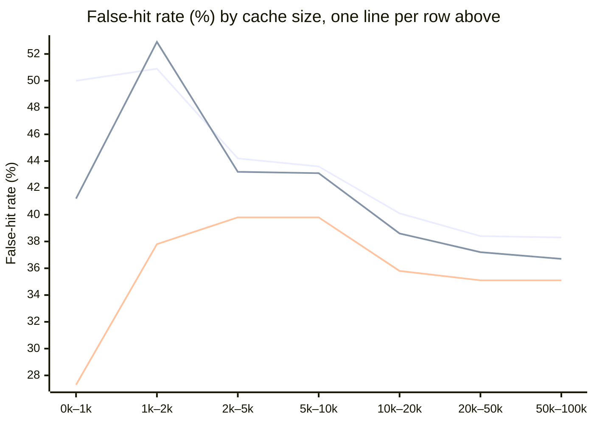

# Public benchmark results

Until now every pakka number came from our own 1,059 LLM-written questions on 30 FAQs. This page runs the same
cache, with and without pakka's guards, on **nine public datasets that other people built and labelled**: about
420,000 questions and sentence pairs in English, Hindi and Hinglish. It compares six embedders, including the
one RedisVL uses by default at RedisVL's default threshold; a seventh, bge-m3, is still pending (see Caveats).
Measured 2 Nov 2026 on a MacBook Air M2 with 8 GB.

## What we found

1. **There is no safe universal threshold.** RedisVL's defaults (`langcache-embed-v1` at similarity 0.90) serve
   more than 5% wrong answers on 6 of 10 datasets: 66% on Hinglish-TOP, 46% on MASSIVE, 35% on vCache
   SearchQueries, 24% on LangCache's own pairs. A threshold picked on one dataset and applied to another breaks
   the budget in most cells of the transfer matrix (0.909 from Banking77 gives 73% false hits on Hinglish-TOP).
   It doesn't carry across embedders either: the e5 models' dev-picked thresholds sit between 0.94 and 0.98,
   where MiniLM's sit between 0.81 and 0.96.
2. **Picking the threshold on a dev split works, when dev looks like the traffic.** On Banking77, CLINC150,
   Bitext and vCache Classification the dev-picked threshold held on test: 1.4% to 4.5% false hits with MiniLM,
   and at worst 5.5% across all six embedders. On LangCache it failed: validation has no QQP, PAWS or APT pairs,
   and test false hits came out at 33–40% for five embedders and 19–24% for `langcache-embed-v1`.
3. **On half the datasets nothing fits a 5% budget at all,** for any of the six embedders: our own set,
   Hinglish-TOP, MASSIVE, vCache LmArena and SearchQueries. Similarity alone can't separate "alarm 6 baje" from
   "alarm 7 baje", "switch on the lights" from "switch off the lights", or "convert jpg to pdf" from "convert pdf
   to jpg". For traffic like that, a semantic cache needs more than a threshold. (Part of this is label noise; see
   Caveats.)
4. **The cache-size curve is about volume, not ratio.** On SearchQueries at 0.90 the share of hits that are wrong
   doesn't climb as the cache grows from 1k to 100k entries (it moves within 27–51% and settles near 35–38%),
   but the hit rate climbs from 1–2% to about 60%. So wrong answers per 100 questions go from 0.3–1 to 21–23.
5. **No embedder wins everywhere.** Mean P-CHR AUC is a tie between MiniLM (pakka's default) and
   `langcache-embed-v1` (0.564). `langcache-embed-v1` is best on English (Bitext 0.856, LangCache 0.677) but
   catches 0% of Hindi questions on MASSIVE. IndicSBERT is the clear pick for Hinglish: best AUC on our set
   (0.690) and Hinglish-TOP (0.316), and at the same hit rate it catches 21% of Hinglish questions where the
   others catch 2–10%.

### Where pakka loses

- **Guards cost more than they save on other people's data.** At the same 5% budget, guards lowered the hit rate
  in 21 cases and raised it in 4. The entity rule (capitalised words) misfires on general text: on vCache
  Classification the guards vetoed 4,321 hits, 4,076 of which were correct, and 3,167 of the vetoes came from
  that rule. The hit rate halved (22% to 12%) for a 1-point drop in false hits. At an equal hit rate the guarded
  cache was no better than the plain one on Banking77, CLINC150 and Bitext.
- **The guards miss the traps these datasets are full of:** on/off, am/pm, from/to direction, buy/sell. These
  are rule gaps for Phase 7, to be fixed on dev splits only.
- **pakka's default embedder isn't the best choice for Hinglish.** IndicSBERT beats it on our own set and on
  Hinglish-TOP; `langcache-embed-v1` beats it on English.
- **On our own HinglishCacheBench nothing fits a 5% budget** with any embedder (v1 needed 10–20%).
- **Where pakka helps:** guards cut RedisVL-default false hits on Bitext from 4.0% to 0.8% and on vCache
  Classification from 9.4% to 5.0% (at a cost in hits), and `pakka bench`'s dev-split method finds a threshold
  that holds when one exists, and says plainly when none does.

## Reproduce

```bash
.venv/bin/python scripts/public_bench.py
```

That one command downloads the datasets from pinned Hugging Face revisions into `data/public/` (gitignored; we
never commit them), embeds every text once per model (cached in `data/public/emb/`), runs every measurement
(cached in `data/public/results/`), and rewrites the tables below. The six models measured here took about 3
hours of compute on a MacBook Air M2 with 8 GB (MiniLM about 10 minutes, each base-size model about 40); after
that a rerun takes seconds. With no arguments it runs all seven models, bge-m3 included, which wants a GPU;
`scripts/public_bench.py <model> ...` measures just those and redraws the tables from everything measured so far.
Delete `data/public/results/` to measure again after changing pakka.

One dataset with the usual CLI:

```bash
.venv/bin/python scripts/fetch_public.py banking77
.venv/bin/pakka bench --data data/public/banking77.jsonl --faqs data/public/banking77.faqs.json --guard \
    --embedder paraphrase-multilingual-MiniLM-L12-v2 --embed-cache data/public/emb
```

## Datasets

| Dataset | Written by | Protocol | Rows (dev / test) | Should hit | Must miss |
|---|---|---|---|---|---|
| [Banking77](https://huggingface.co/datasets/PolyAI/banking77) | People | FAQ, 77 intents | 9,895 / 3,051 | every row: its intent's FAQ | none, so every false hit is a near-intent mix-up |
| [CLINC150](https://huggingface.co/datasets/clinc/clinc_oos) (plus) | People | FAQ, 150 intents | 3,100 / 5,494 | 7,494 in-scope questions | 1,100 out-of-scope questions |
| [Bitext](https://huggingface.co/datasets/bitext/Bitext-customer-support-llm-chatbot-training-dataset) | Generated by Bitext | FAQ, 27 support intents | 11,988 / 12,057 | every row | none |
| [Hinglish-TOP](https://huggingface.co/datasets/WillHeld/hinglish_top) (human split) | People | FAQ, 2,237 parses | 3,782 / 13,243 | 6,124: same parse, English or Hinglish | 8,159 slot traps, 2,742 uncovered |
| [MASSIVE](https://huggingface.co/datasets/AmazonScience/massive) en-US + hi-IN | People | FAQ, 6,237 parses | 12,275 / 13,769 | 18,764: same parse, English or Hindi | 5,621 slot traps, 1,659 uncovered |
| [LangCache sentence pairs](https://huggingface.co/datasets/redis/langcache-sentencepairs-v1) | Mostly people | pairs, 8 sources | 8,405 / 62,021 | 30,035 same-meaning pairs | 40,391 different pairs |
| [vCache LmArena](https://huggingface.co/datasets/vCache/SemBenchmarkLmArena) | Real prompts, LLM variants | stream, 3,500 classes | 12,759 / 51,037 | same class | other class |
| [vCache Classification](https://huggingface.co/datasets/vCache/SemBenchmarkClassification) | Real items, LLM answers | stream, 34 answers | 9,000 / 36,000 | same one-word answer | other answer |
| [vCache SearchQueries](https://huggingface.co/datasets/vCache/SemBenchmarkSearchQueries) | Real search queries, LLM-judged classes | stream, 54,804 classes | 30,000 / 120,000 | same class | other class |
| [HinglishCacheBench v1](../data/README.md) (ours) | LLM, two-LLM labels, human review | FAQ, 30 FAQs | 533 / 526 | 678 | 381 traps and off-topic |

## How each dataset becomes a cache test

- **FAQ protocol** (`pakka bench`, unchanged from v1). The cache is seeded with one question per answer; every
  other question should hit the right one or miss. For intent datasets the first training question of each
  intent is its FAQ. For Hinglish-TOP and MASSIVE the labels come from the human semantic parses: each distinct
  training parse (intent plus slot values, filler words ignored) becomes an FAQ with its English text. A
  question with exactly that parse should hit it, including the seed's own Hinglish or Hindi translation. A
  question with the same intent but different slot values ("alarm 6 baje" vs "alarm 7 baje") is a **slot
  trap** and must miss. Catch-all intents whose slots don't say what is asked (MASSIVE `general_quirky`,
  `qa_factoid`, `qa_maths`, `social_post`; Hinglish-TOP `UNSUPPORTED_*`) only match their own translation.
  MASSIVE Hindi rows whose slot value was localized (Boston became Mumbai) are traps, not hits.
- **Stream protocol** (new, `replay_stream`). Questions arrive in the dataset's order. The cache serves the most
  similar stored question's answer if it clears the threshold; every miss is stored, so the cache grows to
  tens of thousands of entries. A hit is right if both questions share the dataset's equivalence class. The
  first fifth of the stream is dev (threshold picked there), the rest is reported with the cache it built.
- **Pairs protocol** (new, `pair_rows`). Two sentences and a same/different label. A pair scoring above the
  threshold is a hit, and a false hit if it's labelled different. Dev is the validation split, test is test.
- Thresholds are picked on dev so the false-hit rate's 95% Wilson upper bound stays under 5%, and reported on
  test, exactly as v1 does. Guards are `pakka.guard.check`, tuned on our own set only; nothing here was tuned on
  these datasets.
- Every model sees at most 128 tokens per text (MiniLM's own limit), so long LmArena prompts are cut the same way
  for everyone.

<!-- generated by scripts/public_bench.py: start -->
## Main table

Held-out (test) split of each dataset. Each cell is **false-hit rate · hit rate**. "RedisVL defaults" is `redis/langcache-embed-v1` at similarity 0.9 (RedisVL 0.29's out-of-the-box semantic cache), no tuning. "Tuned" picks the threshold on the dev split so the false-hit rate's 95% upper bound stays under 5%, then reports test. LangCache is pairs: hit rate there is the share of pairs scored as the same.

| Dataset | Protocol | Held-out | RedisVL defaults | RedisVL defaults + pakka guards | MiniLM-L12 (pakka default), tuned | … + guards | Best measured embedder, tuned + guards |
|---|---|---|---|---|---|---|---|
| HinglishCacheBench v1 (ours) | faq | 526 | 0.0% · 2% | 0.0% · 2% | no threshold fits | no threshold fits | no threshold fits |
| Banking77 | faq | 3,051 | 4.2% · 3% | 3.4% · 3% | 4.4% · 3% | 4.7% · 3% | langcache-embed-v1: 5.2% · 3% |
| CLINC150 | faq | 5,494 | 1.0% · 4% | 1.0% · 4% | 4.1% · 9% | 4.5% · 8% | MiniLM-L12 (pakka default): 4.5% · 8% |
| Bitext | faq | 12,057 | 4.0% · 5% | 0.8% · 4% | 1.4% · 2% | 0.6% · 1% | langcache-embed-v1: 4.4% · 20% |
| Hinglish-TOP | faq | 13,243 | 65.8% · 8% | 63.9% · 7% | no threshold fits | no threshold fits | no threshold fits |
| MASSIVE en+hi | faq | 13,769 | 46.0% · 8% | 45.9% · 7% | no threshold fits | no threshold fits | no threshold fits |
| LangCache pairs | pairs | 62,021 | 24.3% · 42% | 24.8% · 35% | 35.6% · 22% | 34.8% · 22% | IndicSBERT: 33.1% · 26% |
| vCache LmArena | stream | 51,037 | 7.4% · 90% | 6.6% · 68% | no threshold fits | no threshold fits | no threshold fits |
| vCache Classification | stream | 36,000 | 9.4% · 31% | 5.0% · 14% | 2.4% · 22% | 1.4% · 12% | e5-base: 2.4% · 13% |
| vCache SearchQueries | stream | 120,000 | 35.1% · 54% | 34.9% · 54% | no threshold fits | no threshold fits | no threshold fits |

Not measured yet: bge-m3, marked pending (Kaggle) below (see Caveats).


Label-noise floor of the streams: an exact-match cache (same text after lowercasing) replayed over the whole stream is already "wrong" on vCache LmArena 871 of 9,778 hits (8.9%); vCache Classification 6 of 6,356 hits (0.1%); vCache SearchQueries 102 of 680 hits (15.0%), because identical prompts sit in different equivalence classes. No embedder can beat that floor on these labels.


## Embedders, threshold-free: P-CHR AUC

Area under precision vs cache-hit ratio (higher is better), plain cache, held-out split. It doesn't depend on any threshold, so it compares embedders fairly. Streams have none: what a stream stores depends on the threshold.

| Dataset | MiniLM-L12 (pakka default) | langcache-embed-v1 | e5-small | e5-base | IndicSBERT | LaBSE | bge-m3 |
|---|---|---|---|---|---|---|---|
| HinglishCacheBench v1 (ours) | 0.650 | 0.600 | 0.639 | 0.641 | **0.690** | 0.657 | pending (Kaggle) |
| Banking77 | 0.643 | **0.663** | 0.572 | 0.597 | 0.532 | 0.506 | pending (Kaggle) |
| CLINC150 | **0.722** | 0.716 | 0.675 | 0.710 | 0.575 | 0.592 | pending (Kaggle) |
| Bitext | 0.721 | **0.856** | 0.678 | 0.725 | 0.670 | 0.676 | pending (Kaggle) |
| Hinglish-TOP | 0.183 | 0.200 | 0.199 | 0.187 | **0.316** | 0.218 | pending (Kaggle) |
| MASSIVE en+hi | 0.427 | 0.238 | 0.347 | 0.357 | 0.429 | **0.450** | pending (Kaggle) |
| LangCache pairs | 0.602 | **0.677** | 0.592 | 0.603 | 0.617 | 0.579 | pending (Kaggle) |
| Mean | 0.564 | 0.564 | 0.529 | 0.546 | 0.547 | 0.525 | pending (Kaggle) |

## Embedders at a 5% false-hit budget, with guards

Hit rate on held-out at the dev-picked threshold, with the held-out false-hit rate in brackets: above 5% means the threshold picked on dev didn't hold.

| Dataset | MiniLM-L12 (pakka default) | langcache-embed-v1 | e5-small | e5-base | IndicSBERT | LaBSE | bge-m3 |
|---|---|---|---|---|---|---|---|
| HinglishCacheBench v1 (ours) | none fits | none fits | none fits | none fits | none fits | none fits | pending (Kaggle) |
| Banking77 | 3% (4.7%) | **3%** (5.2%) | 3% (2.4%) | 2% (3.3%) | 1% (3.6%) | 1% (0.0%) | pending (Kaggle) |
| CLINC150 | **8%** (4.5%) | none fits | none fits | 3% (2.8%) | none fits | none fits | pending (Kaggle) |
| Bitext | 1% (0.6%) | **20%** (4.4%) | none fits | 6% (4.5%) | 5% (3.7%) | 4% (3.3%) | pending (Kaggle) |
| Hinglish-TOP | none fits | none fits | none fits | none fits | none fits | none fits | pending (Kaggle) |
| MASSIVE en+hi | none fits | none fits | none fits | none fits | none fits | none fits | pending (Kaggle) |
| LangCache pairs | 22% (34.8%) | 19% (23.7%) | 25% (35.0%) | 26% (33.6%) | **26%** (33.1%) | 19% (39.3%) | pending (Kaggle) |
| vCache LmArena | none fits | none fits | none fits | none fits | none fits | none fits | pending (Kaggle) |
| vCache Classification | 12% (1.4%) | 12% (1.5%) | 12% (1.0%) | **13%** (2.4%) | 13% (2.8%) | 12% (2.2%) | pending (Kaggle) |
| vCache SearchQueries | none fits | none fits | none fits | none fits | none fits | none fits | pending (Kaggle) |

## Do guards help on data they weren't designed for? (MiniLM-L12 (pakka default))

Same budget, threshold picked on dev with and without guards. "Plain at the same hit rate" is the plain cache's held-out false-hit rate if it served as many questions as the guarded one did.

| Dataset | Plain, tuned | Guards, tuned | Plain at the same hit rate | Good hits vetoed | Vetoes by rule |
|---|---|---|---|---|---|
| HinglishCacheBench v1 (ours) | no threshold fits | no threshold fits | - | - | - |
| Banking77 | 4.4% · 3% | 4.7% · 3% | 4.7% | 5 | entity 4, negation 1 |
| CLINC150 | 4.1% · 9% | 4.5% · 8% | 3.8% | 44 | negation 15, slot 29 |
| Bitext | 1.4% · 2% | 0.6% · 1% | 0.0% | 17 | negation 5, slot 12 |
| Hinglish-TOP | no threshold fits | no threshold fits | - | - | - |
| MASSIVE en+hi | no threshold fits | no threshold fits | - | - | - |
| LangCache pairs | 35.6% · 22% | 34.8% · 22% | 35.6% | 740 | entity 1047, negation 53, slot 171 |
| vCache LmArena | no threshold fits | no threshold fits | - | - | - |
| vCache Classification | 2.4% · 22% | 1.4% · 12% | - | 4076 | entity 3167, negation 383, slot 771 |
| vCache SearchQueries | no threshold fits | no threshold fits | - | - | - |

Across the 6 measured embedders and 10 datasets, guards raised the hit rate at the same budget in 4 cases and lowered it in 21.

## Threshold transfer (MiniLM-L12 (pakka default), plain)

Each row picks its threshold on one dataset's dev split (5% budget); each column applies it to another dataset's held-out split. Cells are **false-hit rate · hit rate**; bold means the measured false-hit rate itself is over the 5% budget. The diagonal is the honest in-domain number.

| Picked on ↓ / applied to → | HinglishCacheBench v1 (ours) | Banking77 | CLINC150 | Bitext | Hinglish-TOP | MASSIVE en+hi | LangCache pairs | vCache LmArena | vCache Classification | vCache SearchQueries |
|---|---|---|---|---|---|---|---|---|---|---|
| HinglishCacheBench v1 (ours) (none fits) | - | - | - | - | - | - | - | - | - | - |
| Banking77 (0.909) | 0.0% · 3% | 4.4% · 3% | 1.1% · 2% | 0.6% · 1% | **73.0% · 8%** | **33.9% · 13%** | **34.3% · 33%** | **7.8% · 87%** | 4.9% · 25% | **36.5% · 53%** |
| CLINC150 (0.810) | **13.3% · 9%** | **17.0% · 17%** | 4.1% · 9% | **9.5% · 8%** | **78.7% · 25%** | **56.7% · 40%** | **36.8% · 51%** | **9.2% · 97%** | **19.3% · 54%** | **54.4% · 76%** |
| Bitext (0.902) | 0.0% · 3% | **5.7% · 3%** | 0.9% · 2% | 1.4% · 2% | **72.9% · 9%** | **36.1% · 15%** | **34.2% · 34%** | **7.9% · 89%** | **5.9% · 27%** | **38.0% · 55%** |
| Hinglish-TOP (none fits) | - | - | - | - | - | - | - | - | - | - |
| MASSIVE en+hi (none fits) | - | - | - | - | - | - | - | - | - | - |
| LangCache pairs (0.955) | 0.0% · 2% | 0.0% · 1% | 3.7% · 0% | 0.0% · 0% | **64.8% · 2%** | **25.7% · 4%** | **35.6% · 22%** | **7.6% · 69%** | 0.9% · 20% | **25.0% · 35%** |
| vCache LmArena (none fits) | - | - | - | - | - | - | - | - | - | - |
| vCache Classification (0.930) | 0.0% · 2% | 0.0% · 1% | 1.8% · 1% | 0.0% · 1% | **70.0% · 5%** | **29.8% · 9%** | **34.5% · 28%** | **7.7% · 81%** | 2.4% · 22% | **31.6% · 46%** |
| vCache SearchQueries (none fits) | - | - | - | - | - | - | - | - | - | - |

## LangCache pairs by source

Redis's own sentence-pair benchmark, test split. Each cell is **false-hit rate · duplicates caught** (share of same-meaning pairs scored as hits). The tuned threshold comes from the validation split, which has no QQP, PAWS or APT pairs.

| Source | Pairs (same) | AUC MiniLM-L12 (pakka default) | AUC langcache-embed-v1 | MiniLM-L12 (pakka default) at 0.955 | RedisVL defaults (0.9) |
|---|---|---|---|---|---|
| apt | 1,252 (799) | 0.762 | 0.749 | 15.0% · 19% | 27.6% · 52% |
| mrpc | 1,725 (1,147) | 0.828 | 0.826 | 5.8% · 17% | 18.4% · 61% |
| parade | 1,357 (650) | 0.705 | 0.718 | 0.0% · 2% | 4.6% · 16% |
| paws | 10,000 (5,000) | 0.614 | 0.681 | 48.4% · 88% | 47.9% · 96% |
| pit2015 | 972 (175) | 0.382 | 0.395 | 0.0% · 1% | 12.0% · 25% |
| qqp | 40,430 (14,885) | 0.632 | 0.715 | 14.5% · 22% | 7.3% · 83% |
| sick | 4,906 (4,194) | 0.905 | 0.839 | 1.3% · 14% | 18.9% · 31% |
| stsb | 1,379 (0) | n/a, no same pairs | n/a, no same pairs | 100.0% · - | 100.0% · - |

## False hits as the cache grows (vCache SearchQueries)

The 150,000 search queries replayed in order, every miss stored. Questions are grouped by how many entries the cache held when they arrived; the threshold stays where dev (the first 30,000) put it. Each cell is **false-hit rate · hit rate · wrong answers per 100 questions**.

| Cache size when asked → | 0k–1k | 1k–2k | 2k–5k | 5k–10k | 10k–20k | 20k–50k | 50k–100k |
|---|---|---|---|---|---|---|---|
| MiniLM-L12 (pakka default) at 0.9 (none fits dev) | 50.0% · 2% · 1.0 | 50.9% · 5% · 2.7 | 44.2% · 11% · 5.0 | 43.6% · 20% · 8.8 | 40.1% · 33% · 13.4 | 38.4% · 49% · 19.0 | 38.3% · 61% · 23.4 |
| MiniLM-L12 (pakka default) + guards at 0.9 (none fits dev) | 41.2% · 2% · 0.7 | 52.9% · 5% · 2.6 | 43.2% · 11% · 4.6 | 43.1% · 19% · 8.2 | 38.6% · 31% · 12.0 | 37.2% · 47% · 17.4 | 36.7% · 58% · 21.5 |
| RedisVL defaults (0.9) | 27.3% · 1% · 0.3 | 37.8% · 4% · 1.6 | 39.8% · 11% · 4.3 | 39.8% · 19% · 7.6 | 35.8% · 31% · 11.2 | 35.1% · 48% · 16.7 | 35.1% · 59% · 20.8 |



## English, Hinglish and Hindi written by people

No embedder has a threshold that meets the budget on Hinglish-TOP or MASSIVE, so here each one serves the 10% of held-out questions it scores highest, with guards (the same hit rate for all). Columns: false-hit rate of those hits, share of each language's should-hit questions answered right, and how many hits were slot traps (same intent, different slot value).

| Embedder | Hinglish-TOP false-hit rate | English caught | Hinglish caught | Slot-trap false hits | MASSIVE false-hit rate | English caught | Hindi caught | Slot-trap false hits |
|---|---|---|---|---|---|---|---|---|
| MiniLM-L12 (pakka default) | 66.2% | 23% | 5% | 521 | 31.0% | 9% | 10% | 118 |
| langcache-embed-v1 | 66.2% | 25% | 4% | 523 | 51.4% | 16% | 0% | 91 |
| e5-small | 69.6% | 22% | 3% | 575 | 58.5% | 14% | 0% | 133 |
| e5-base | 72.1% | 22% | 2% | 571 | 54.6% | 15% | 0% | 128 |
| IndicSBERT | 43.7% | 13% | 21% | 351 | 35.5% | 10% | 9% | 101 |
| LaBSE | 64.5% | 16% | 10% | 471 | 27.2% | 6% | 14% | 115 |
| bge-m3 | pending (Kaggle) | pending (Kaggle) | pending (Kaggle) | pending (Kaggle) | pending (Kaggle) | pending (Kaggle) | pending (Kaggle) | pending (Kaggle) |
<!-- generated by scripts/public_bench.py: end -->

## Caveats

- **Labels are other people's, and some are wrong.** That's the point of using them, but read the numbers with it in
  mind. vCache's equivalence classes put identical prompts in different classes (the exact-match floor above), and
  split obvious paraphrases ("costco black friday 2018 deals" vs "costco black friday deals 2018") while merging a
  reversed question ("substitute baking soda for baking powder" and the opposite). In a hand read of 30
  SearchQueries false hits at 0.90, about 9 looked like the same question and about 21 were really wrong (direction
  flips, swapped numbers or places). Parse labels from Hinglish-TOP and MASSIVE are noisy for slotless or
  inconsistently annotated parses ("Add this song to my favorites , please ." and the same sentence without "please"
  have different parses; one Hindi row is marked "translation" although the place name was localized). Phase 7
  audits a sample of hits with two LLMs to put a number on label noise per dataset.
- **One seed question per FAQ.** Banking77, CLINC150 and Bitext use the first training question of each intent as
  its FAQ, not a written canonical question. A real FAQ cache usually holds a cleaner question, sometimes several.
- **Truncation.** Every model sees at most 128 tokens per text. That only affects long LmArena and Classification
  prompts.
- **bge-m3 is not measured yet.** On this 8 GB laptop it would take hours and push swap past its limit. Its columns
  say "pending (Kaggle)" rather than show numbers from a trimmed dataset. bge-m3 is loaded with float16 weights
  (`HALF` in the script) so it fits in memory; other models run in float32. To fill those columns on a free Kaggle
  GPU (the Phase 6 code must be on GitHub first):

  ```bash
  git clone https://github.com/mohammedp010/pakka && cd pakka && pip install -e .
  python scripts/public_bench.py BAAI/bge-m3
  ```

  Then copy Kaggle's `data/public/results/BAAI__bge-m3/` into the same folder here and run
  `.venv/bin/python scripts/public_bench.py` again: with every model measured it only rewrites the tables.
- **Not compared yet:** vCache's own reported numbers. Its paper reports error rate per request (false hits ÷ all
  questions), not per served hit as here, so the two don't line up without care.
