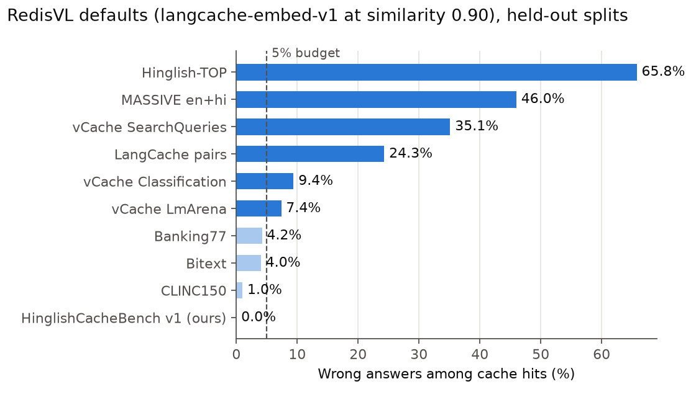
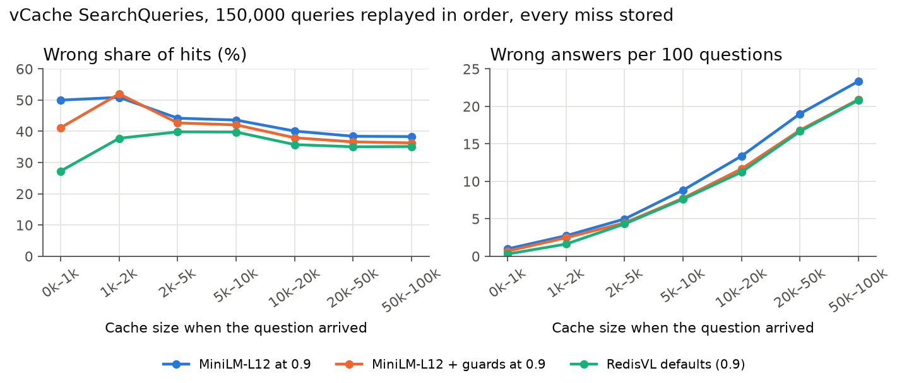
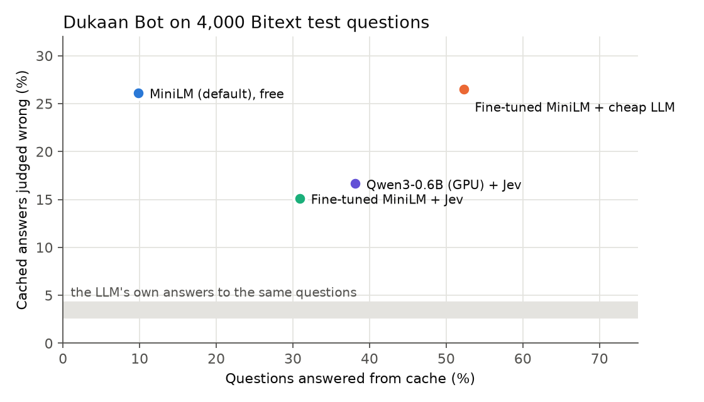

# How often does a semantic cache serve a wrong answer? A short report on pakka v2

mohammedp010, November 2026. Code, data and every number: [github.com/mohammedp010/pakka](https://github.com/mohammedp010/pakka).
Full tables: [public_results.md](public_results.md). Lab notebook of v1: [results.md](results.md).

## 1. Problem

A semantic cache embeds each question, finds the most similar stored question, and serves its answer when the
similarity clears a threshold. It skips an LLM call that takes about a second and costs money. The risk is a
**false hit**: a question that looks like a stored one but needs a different answer. "Refund nahi mila" sits
next to "How long does a refund take?"; "alarm 6 baje" next to "alarm 7 baje"; "convert jpg to pdf" next to
"convert pdf to jpg". Gateways report hit rate. They rarely report how many of those hits were wrong, and
nobody publishes it for Hinglish.

pakka v1 (a library, rule guards and a 1,059-question benchmark) answered that on data we wrote ourselves. v2
asked the question a developer would ask first: **does it hold on data you didn't write?**

## 2. Method

**Data.** Nine public datasets other people built and labelled, about 420,000 questions and sentence pairs in
English, Hindi and Hinglish: Banking77, CLINC150, Bitext, Hinglish-TOP, MASSIVE (en-US + hi-IN), Redis's
LangCache sentence pairs, and vCache's LmArena, Classification and SearchQueries. Plus our own
HinglishCacheBench v1 (1,059 LLM-written questions on 30 FAQs) and a new **human split**: 315 messages 23 people
wrote through a form in their own words, 80% romanized Hinglish ([dataset card](../data/README.md)). Datasets are
downloaded from pinned revisions and never committed.

**Three protocols**, so each dataset is tested the way it was built:

| Protocol | How it works | Datasets |
|---|---|---|
| FAQ | The cache holds one seed question per answer; every other question should hit the right one or miss. For Hinglish-TOP and MASSIVE the human semantic parses give the labels: same parse is a hit, same intent with other slot values ("6 baje" vs "7 baje") is a slot trap that must miss | ours, Banking77, CLINC150, Bitext, Hinglish-TOP, MASSIVE |
| Stream | Questions arrive in order and every miss is stored, so the cache grows to tens of thousands of entries. A hit is right if both questions share an equivalence class | vCache's three sets |
| Pairs | Two sentences and a same / different label; a pair above the threshold is a hit | LangCache |

**Thresholds are picked on dev, reported on test.** For each dataset and embedder, `pakka bench` picks the lowest
threshold whose false-hit rate on the dev split has a **95% Wilson upper bound** under the budget (5%, or 10%
for our small sets), then reports the held-out split at that threshold. When no threshold fits on dev, it says
so instead of picking one that fails on test. RedisVL's defaults (`redis/langcache-embed-v1` at similarity 0.90)
are run as-is, no tuning, as the baseline a developer gets out of the box. P-CHR AUC (area under precision vs
cache-hit ratio) compares embedders without any threshold. Ten embedders were measured: eight local, two through
an API.

**Guards** (`pakka.guard.check`) are word rules that veto a hit in about 60 µs: negation (with hedges like "pata
nahi" and failure reports like "nahi ho raha" excluded), numbers and IDs, days and times, opposite actions
(on/off, buy/sell), swapped direction ("pdf to jpg"), and names the cached question never mentions. They were
tuned on our own set in v1, then fixed in v2 by reading vetoes on **dev splits only**; test splits were not looked
at until the rules were frozen.

**Verifier** (optional, `CachedAnswerer(verify=...)`). Every hit at similarity 0.6 or more that the guards let
through gets one more question, "would the reply for the cached question also answer this one?", and is served
only on a yes. Two built-ins: TypeSafe's Jev (a score, passing at 0.84) and any OpenRouter model (yes / no;
`qwen/qwen3.7-flash`, the cheapest of five tried). Text is PII-masked first; an error or timeout is a miss.

**Label audit.** Public labels are not answers, so three LLMs from three families (DeepSeek and Haiku on every
pair, GPT-5.4 settling their splits) judged 1,455 sampled hits without seeing the labels: *would the answer to A
also be a correct answer to B as asked?* Total cost $0.47.

**Fine-tuning** (Phase 9). MiniLM-L12 trained for one epoch on dev splits and LangCache's train split, with every
text that appears in any test split or the human set dropped. Four leave-one-dataset-out runs, one of which never
saw any of our own data, check that the gain isn't leakage.

**Real bot** (Phase 10). Dukaan Bot, with Bitext's 27 seed questions and answers as its knowledge base and
`claude-haiku-5.5` as its LLM, replayed 4,000 held-out Bitext test questions. Nothing was stored during the
replay. Every reply the cache served, and the LLM's own reply to the same question as a control, went to the
audit's three judges: *is this reply a correct answer to the message as asked?*

## 3. Results



**1. There is no safe universal threshold.** RedisVL's defaults serve more than 5% wrong answers on 6 of 10
datasets: 66% on Hinglish-TOP, 46% on MASSIVE, 35% on vCache SearchQueries, 24% on LangCache's own pairs, 9% on
vCache Classification and 7% on LmArena. A threshold picked on one dataset breaks the budget on most others (0.909
from Banking77 gives 73% false hits on Hinglish-TOP), and thresholds don't carry across embedders either (e5
models land at 0.94–0.98, MiniLM at 0.81–0.96).

**2. Picking the threshold on dev works when dev looks like the traffic.** On Banking77, CLINC150, Bitext and vCache
Classification the dev-picked threshold held on test: 1.4–4.5% false hits with MiniLM, at worst 6.0% across all
ten embedders. On half the datasets (ours, Hinglish-TOP, MASSIVE, stratified LangCache, LmArena, SearchQueries)
**nothing fits a 5% budget for any embedder**. Similarity alone can't separate the slot, direction and on/off
traps.

**3. Cache size changes volume, not ratio.** On SearchQueries at 0.90 the wrong share of hits stays around 35–38% as
the cache grows from 1k to 100k entries, but the hit rate climbs from 1–2% to about 60%, so wrong answers per 100
questions go from 0.3–1 to 21–23.



**4. Guards help on structural traps, cost a little elsewhere.** They cut RedisVL-default false hits on Hinglish-TOP
from 65.8% to 61.4%, and the judges back 112 of 166 audited vetoes the labels call wrong. At the same 5% budget they
still lower the hit rate in 36 of 46 cases where a threshold fits (median −0.3 points, worst −4.2) and raise it in 9.
On real Hinglish they misread "nahi" used to describe a problem; Phase 8 fixed most of that on dev.

**5. A better embedder helps; a verifier helps more.** Qwen3-Embedding-0.6B has the best local mean AUC (0.647 vs
MiniLM's 0.571; Qwen3-8B through an API 0.699) but takes 235 ms a question on a CPU, against 9 ms for MiniLM, so
MiniLM stays the default. On the 258 human messages (cells: right / wrong served, 95% upper bound):

| Setup | Human test (258) |
|---|---|
| MiniLM-L12 (default), free | 2 / 1 (79.2%) |
| Qwen3-0.6B, free | 11 / 0 (25.9%) |
| MiniLM + Jev | 19 / 0 (16.8%) |
| Fine-tuned MiniLM + Jev | 54 / 1 (9.6%) |
| Qwen3-0.6B + Jev | 80 / 1 (6.7%) |
| Qwen3-0.6B + cheap LLM | 113 / 9 (13.4%) |

The fine-tuned MiniLM is no better free (AUC 0.603 → 0.589) but lifts 165 of 258 real messages above the
verifier's 0.6 floor instead of 26, and the verifier sorts them. The same recipe on Qwen3-0.6B didn't help and
wasn't shipped.

**6. In a real bot, as shipped, the cache saves money and is wrong 6–9 times as often as the LLM (Phase 10).**

| Setup | Answered from cache | Wrong (judges) | LLM wrong, same questions | Hit p50 | Spend saved, verifier paid |
|---|---|---|---|---|---|
| MiniLM, free | 9.8% | 103 / 394 (26.1%) | 12 (3.0%) | 9 ms | 9.9% |
| Fine-tuned MiniLM + cheap LLM | 52.3% | 554 / 2,091 (26.5%) | 89 (4.3%) | 777 ms | 51.3% |
| Fine-tuned MiniLM + Jev | 30.9% | 187 / 1,236 (15.1%) | 33 (2.7%) | 326 ms | 27.8% |
| Qwen3-0.6B (M2 GPU) + Jev | 38.1% | 254 / 1,525 (16.7%) | 41 (2.7%) | 379 ms | 35.1% |



A no-cache LLM call took 1,248 ms at the median and the baseline cost $2.03. Bitext's `cancel_order` answer ("you
have a question about cancelling, please go ahead and ask it") causes 27 of the free setup's 103 wrong answers and
61 of Jev's 187; the five worst FAQs cause 72–80%. Without it, Jev's wrong rate is 10.7%. The cheap yes / no LLM
verifier says yes too easily on Bitext's near intents. Intent labels would have flagged 51 of the free setup's
wrong answers; the judges found 103.

**7. With complete answers, dev-picked thresholds and a verifier that reads the reply, it reaches the LLM's level
(Phase 10b).** Three changes, every choice made on 3,000 Bitext dev questions and reported on the same 4,000 test
questions: (a) the 13 FAQ answers behind most right-intent wrong answers on dev were rewritten into complete ones;
(b) thresholds picked with pakka's own rule, a 95% Wilson upper bound within 3% on dev; (c) LLM verifiers that see
the stored reply and give P(yes) from logprobs, alone or with Jev ("agree").

| Setup (fixed KB, 3% budget) | Answered from cache | Wrong (judges, 95% upper) | LLM wrong, same questions | Hit p50 | Spend saved, verifier paid |
|---|---|---|---|---|---|
| Fine-tuned MiniLM, free | none fits on dev | | | | |
| Fine-tuned MiniLM + Jev | 11.3% | 10 / 453 (2.2%, 4.0%) | 11 (2.4%) | 326 ms | 9.8% |
| Fine-tuned MiniLM + Qwen3.5-397B (open weights) | 44.0% | 43 / 1,758 (2.4%, 3.3%) | 69 (3.9%) | 896 ms | 19.6% |
| Fine-tuned MiniLM + agree (Jev and Qwen3.5-397B) | 34.4% | 28 / 1,376 (2.0%, 2.9%) | 45 (3.3%) | 899 ms | 5.7% |

The rewrite alone, at Phase 10's settings, takes fine-tuned MiniLM + Jev from 15.1% to 5.4% wrong. On the original
KB no setup fits 3% on dev, and the 5% pick is 8.9% wrong on test: Bitext's dev and test phrasings differ enough
that a dev-picked threshold under-covers there. On the questions these setups serve, the LLM's own replies are wrong
more often than the cache's. Over all 4,000 questions the LLM is wrong on 5.3%, more than Phase 10's "3–4%", which
covered only the questions the cache answered. At this budget the cache is a wrong-answer filter with a modest saving: the Qwen check costs a third of an
LLM call and runs on every candidate.

## 4. Limitations

**v1 overstated what a cache can answer.** v1's test questions were written by an LLM, and the same LLM wrote
dev and test in the same prompts. With the threshold picked on v1 dev, the cache answers 10–21% of v1 test but
1–4% of real people's messages; with the free default, 47 of 526 v1 test questions against 2 of 258 human ones. Real
messages are longer and carry context ("password yaad nhi aa raha, login nahi ho paa raha, naya kaise banaye"), so
they sit further from the FAQ question. v1's fine-tuning gain was partly the generator's writing style: on the 46
hand-written held-out questions, paraphrases caught only rose from 11 to 13 of 27. v2 found this by testing on data
it didn't write (Phases 6 and 8), and every v1 number below should be read that way.

v1's own results, MiniLM-L12, 526 held-out v1 questions:

| Setup | Right | Wrong | False-hit rate (95% upper bound) | Hinglish caught |
|---|---|---|---|---|
| Plain cache, 20% budget | 55 | 12 | 17.9% (28.7%) | 12/200 |
| + pakka guards, 10% budget | 49 | 5 | 9.3% (19.9%) | 11/200 |
| + fine-tuned encoder and approved keys, 10% budget | 70 | 2 | 2.8% (9.6%) | 32/200 |

In v1's real-bot run on the same 526 questions, 13% were answered from cache with 2 wrong, in 56 ms instead of
1,331 ms. The set is built to be hard (35% must miss, 55% is Hinglish), but it is still one LLM's writing.

**Bitext's labels, and intent labels in general.** Bitext is generated, and like Banking77 and CLINC150 it labels
intent, not answers. The audit's judges call 39–52% of these datasets' "correct" hits wrong (same intent, a different
request: "set the timer for 10 minutes" served the answer to "a 4 minute timer"), so their low false-hit rates in the
public tables are optimistic for a cache that serves whole answers. That is why Phase 10 judged replies with LLMs:
intent labels flag 51 of the free setup's wrong answers, the judges 103. Some of Bitext's seed answers only fit their
own seed question (`cancel_order` above), which a curated FAQ would avoid.

**Other label noise.** The judges overturn 6–46% of sampled hit labels per public dataset (vCache SearchQueries 35%,
LmArena 23%; 68% of LmArena's labelled false hits look fine). Parse labels split the same request ("30 mins" vs "30
minutes"). An exact-match cache is already "wrong" on 8.9% of LmArena hits and 15.0% of SearchQueries hits. The
judges themselves disagree: in Phase 10 DeepSeek and Haiku split on 28% of replies (Haiku stricter), and a hand read
of 25 splits found the majority right on about 21. In Phase 10b they split on 24%; on the best setup's hits, 15%, enough to move a 2.4%
wrong rate by about a point either way. The 10b verifier asks nearly the judges' question (different model
families), and the rewritten answers were written by an LLM, so a 2–3% figure means "about the LLM's rate", not
a precise number.

**Other limits.**
- Guards were changed after reading the public dev splits, so their held-out numbers are honest but the rules are
  no longer "never seen this data". The human test split is not fully held out for the Phase 8 negation fix: its
  failures are how the problem was found.
- The human set is small (258 test messages, 23 writers, one shop's 30 FAQs); bounds are wide.
- Phase 10's bot LLM answered 28% of English questions in Hinglish because of its prompt. Fixed after the run; the
  baseline was not re-run. The judges were asked about content, not language.
- Qwen3-0.6B's real-bot numbers ran on the M2's GPU; on a CPU add about 235 ms a question.
- One seed question per intent stands in for a curated FAQ; every model sees at most 128 tokens; API embedders run on
  whichever provider OpenRouter routes to. vCache's own reported numbers are not compared (its paper reports error
  per request, not per served hit).
- The best results need a paid API verifier. Off-the-shelf cross-encoder verifiers made every result worse.

**Cost.** The largest OpenRouter items: Phase 10 $3.73, Phase 10b $4.94, the two API embedders about $0.70 for every dataset, the
label audit $0.47, Phase 8.5 $0.08. Jev checks came to about $1.10. Training ran on a free Kaggle T4; everything else
on a MacBook Air M2.

## Reproduce

All commands run from the repo root with `.venv/bin/` in front. Keys (`OPENROUTER_API_KEY`, `TYPESAFE_API_KEY`) go
in `.env`. Every embedding, LLM call and verdict is cached under `data/public/`, so reruns are free.

```bash
python scripts/public_bench.py                 # 9 datasets x 10 embedders, every table in public_results.md
python scripts/label_audit.py                  # the label audit (~$0.10 the first time)
python scripts/phase9_data.py                  # fine-tuning data; training runs on Kaggle: scripts/phase9_kaggle.py
python scripts/phase9_eval.py                  # fine-tuned model, free tables
python scripts/phase10_bot.py --setups free,tuned+llm,tuned+jev,qwen+jev   # the real bot (~70 min first time)
python scripts/phase10b.py                          # Phase 10b (~90 min first time)
pip install matplotlib && python scripts/charts.py                         # the charts in this report
pakka bench --data data/bench_v1.jsonl --guard --budget 0.10 --fail-above 0.25   # the CI gate
```

Free vs verifier on our sets:

```bash
(jq -c 'select(.split=="dev")' data/bench_v1.jsonl; jq -c 'select(.split=="test")' data/bench_human.jsonl) > data/public/human_eval.jsonl
for f in data/bench_v1.jsonl data/public/human_eval.jsonl; do for b in 0.05 0.10; do
  pakka bench --data $f --guard --budget $b --verify jev-1.14.0 --verify openrouter:qwen/qwen3.7-flash --embed-cache data/public/emb
done; done
```
